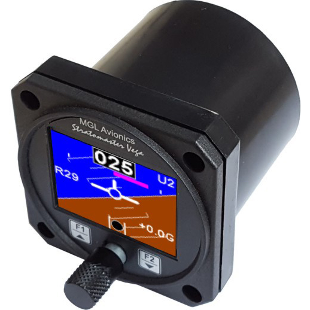
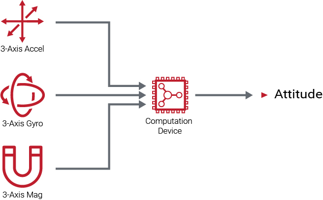

# Attitude and heading reference systems (AHRS)

[Read More](#read-more)

[Video](#video)

------------------------------------------------------------------------------------------------------------

Attitude and heading reference systems (AHRS) have been providing heading and attitude information with greater accuracy and reliability than traditional mechanical gyros for years now. But how do these solid-state systems deliver this information, and how do they do so using increasingly smaller and lighter equipment?

**Micro Electronics**

An AHRS’s key features include ­micro-electronic mechanical gyros, ­accelerometers and a magnetometer or flux valve. The micro-electronic mechanical gyros are responsible for capturing motion data as an aircraft moves about all three axes. They do this by ­using vibrating components. As an aircraft changes direction, these vibrations deviate, and these deviations can be measured and used to calculate directional change data.

**Gyro Drift**

Gyros measure angular rate; accelerometers measure specific force, not gravity independently. During maneuvers, specific force includes the effects of aircraft acceleration, so a simple accelerometer reading is not a direct attitude reference. Sensor fusion estimates attitude using gyro and accelerometer measurements and may use magnetic, GNSS or other aiding according to design.

The AHRS aggregates all the information from these different components and conducts complex algorithms and calculations to provide highly reliable attitude and heading data.

## Read More

[FAA AMT Airframe handbook — aircraft instruments](https://www.faa.gov/regulations_policies/handbooks_manuals/aviation/FAA-H-8083-31B_Aviation_Maintenance_Technician_Handbook.pdf)

[AHRS](https://en.wikipedia.org/wiki/Attitude_and_heading_reference_system)

## Video

[AHRS SYSTEM EXPLAINED | Attitude and Heading Reference System](https://youtu.be/YO0m7O6DAww?si=F2dn0EHBfLvNzxDu)

[AHRS - Attitude and Heading Reference System](https://youtu.be/_-bP_N9Xt38?si=xoVKWX63ltiFBP0z)
