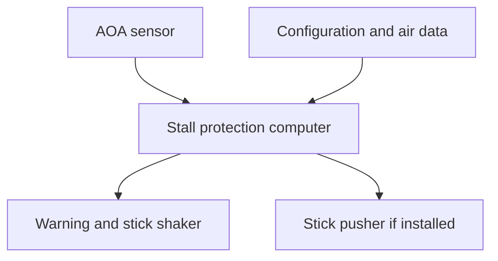

------------------------------------------------------------------------------------------------------------
# Angle of Attack and Stall Protection

[Operation](#operation)

[System Diagram](#system-diagram)

[Testing](#testing)

[More Reading](#more-reading)

------------------------------------------------------------------------------------------------------------

Angle of attack is the angle between a reference chord and the relative airflow. Stall protection uses sensed or computed AOA and aircraft configuration to warn of approaching aerodynamic limits.

## Operation

**AOA sensors:** Heated vanes or other sensing designs provide local airflow information. Sensor calibration and installation geometry matter.

**Stall protection computer:** May use flap/slat position, air data, icing inputs and AOA to set warning thresholds. Stick shakers provide tactile warning; stick pushers on equipped aircraft command nose-down control.

**Interfaces:** Outputs may include discretes, analog signals or digital bus data. Redundant channels can be compared by monitoring logic.

## System Diagram

Conceptual signal flow; individual aircraft configurations vary.

## Testing

A mismatch can originate in sensor alignment, heating, wiring, configuration inputs or processing. The output warning is not proof of a defective vane. Use manufacturer test equipment and safe provisions for shaker or pusher activation.

Training theory only; use applicable aircraft and equipment maintenance instructions for live tests and limits.

### More Reading

[FAA Aviation Maintenance Technician Handbook – Airframe, Chapter 10](https://www.faa.gov/regulations_policies/handbooks_manuals/aviation/FAA-H-8083-31B_Aviation_Maintenance_Technician_Handbook.pdf) — foundational reference; modern system details are supplementary training theory.

[Related lesson: Air Data Computer](../Air%20Data%20Computer/README.md)

[Back to DuncanU](../README.md)
