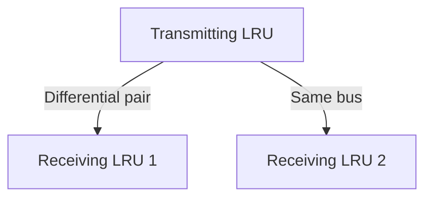

------------------------------------------------------------------------------------------------------------
# ARINC 429 Digital Data Bus

[Operation](#operation)

[System Diagram](#system-diagram)

[Testing](#testing)

[More Reading](#more-reading)

------------------------------------------------------------------------------------------------------------

ARINC 429 is a widely installed unidirectional avionics interface. A transmitter drives a differential twisted pair and one or more receivers listen; a separate pair is needed for a return path.

## Operation

**Signal characteristics:** Bipolar return-to-zero signaling represents one, zero and null. Common nominal bit rates are 12.5 and 100 kbit/s; actual installation requirements control.

| Word bits | Common function |
| --- | --- |
| 1–8 | Label |
| 9–10 | SDI where applicable |
| 11–29 | Data, depending on label format |
| 30–31 | Sign/status matrix or other format-dependent use |
| 32 | Odd parity |

Labels are conventionally expressed in octal. BNR, BCD and discrete formats interpret fields differently. A word with valid parity can still contain invalid sensor data.

## System Diagram

Conceptual signal flow; individual aircraft configurations vary.

## Testing

Use an approved high-impedance differential interface or bus analyzer. Compare expected labels, rate, refresh interval, status and signal quality. A missing label, invalid status and electrical bus failure are different problems; avoid assuming a generic label meaning across installations.

Training theory only; use applicable aircraft and equipment maintenance instructions for live tests and limits.

### More Reading

[FAA Aviation Maintenance Technician Handbook – Airframe, Chapter 11](https://www.faa.gov/regulations_policies/handbooks_manuals/aviation/FAA-H-8083-31B_Aviation_Maintenance_Technician_Handbook.pdf) — foundational reference; modern system details are supplementary training theory.

[Related lesson: Avionics Interfaces](../Avionics%20Interfaces/README.md)

[Back to DuncanU](../README.md)
