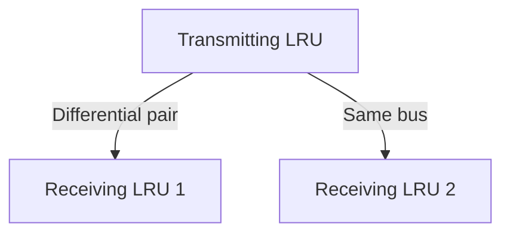

------------------------------------------------------------------------------------------------------------
# ARINC 429 Digital Data Bus

[Operation](#operation)

[System Diagram](#system-diagram)

[Testing](#testing)

[More Reading](#more-reading)

[Videos](#videos)

------------------------------------------------------------------------------------------------------------

ARINC 429 is a widely installed unidirectional avionics interface. A transmitter drives a differential twisted pair and one or more receivers listen; a separate pair is needed for a return path.

## Operation

**Signal characteristics:** Bipolar return-to-zero signaling represents one, zero and null. Common nominal bit rates are 12.5 and 100 kbit/s. Nominal differential transmitter states are +10 V (one), −10 V (zero) and 0 V (null); each active state returns to null within the bit. Receiver thresholds and rise/fall times are specified separately; these nominal values are not acceptance limits.

| Word bits | Common function |
| --- | --- |
| 1–8 | Label |
| 9–10 | SDI where applicable |
| 11–29 | Data, depending on label format |
| 30–31 | Sign/status matrix or other format-dependent use |
| 32 | Odd parity |

Labels are conventionally expressed in octal. The eight label bits are sent first, most-significant label bit first; remaining bits follow the word's defined transmission order. BNR encodes binary numerical values, BCD encodes decimal digits, and discrete words carry individual status states. SSM interpretation and data scaling are label-specific. A word with valid parity can still contain invalid sensor data.

## System Diagram

Conceptual signal flow; individual aircraft configurations vary.

## Testing

Use an approved high-impedance differential interface or bus analyzer. Compare expected labels, rate, refresh interval, status and signal quality. A missing label, invalid status and electrical bus failure are different problems; avoid assuming a generic label meaning across installations.

Training theory only; use applicable aircraft and equipment maintenance instructions for live tests and limits.

### More Reading

[United Electronic Industries — ARINC 429 tutorial and reference](https://www.ueidaq.com/arinc-429-tutorial-reference-guide)

[FAA Aviation Maintenance Technician Handbook – Airframe, Chapter 11](https://www.faa.gov/regulations_policies/handbooks_manuals/aviation/FAA-H-8083-31B_Aviation_Maintenance_Technician_Handbook.pdf) — foundational reference; modern system details are supplementary training theory.

[Related lesson: Avionics Interfaces](../Avionics%20Interfaces/README.md)

[AIM — ARINC 429 and AFDX technical tutorials](https://www.aim-online.com/products-overview/tutorials/)

### Videos

[United Electronic Industries — ARINC 429 Tutorial and Reference (embedded video)](https://www.ueidaq.com/arinc-429-tutorial-reference-guide)

[Avionics Interface Technologies — Engineering Units Display demonstration](https://aviftech.com/f-sim-429-eu/)

[Back to DuncanU](../README.md)
