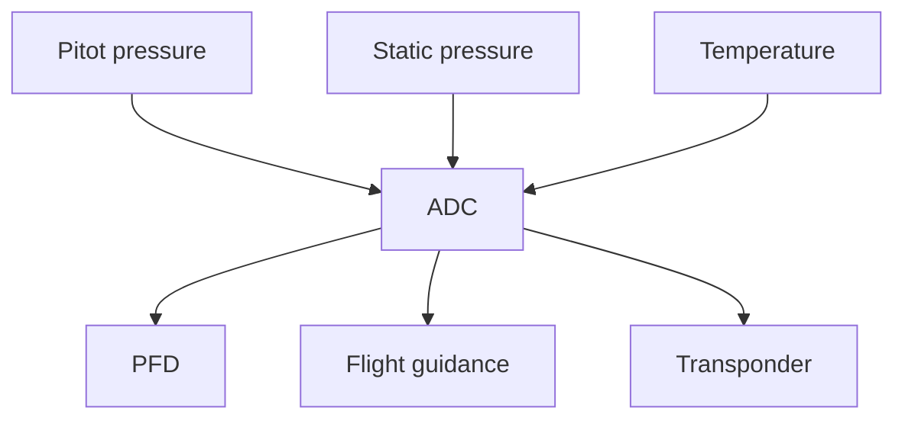

------------------------------------------------------------------------------------------------------------
# Air Data Computer (ADC)

[Operation](#operation)

[System Diagram](#system-diagram)

[Testing](#testing)

[More Reading](#more-reading)

------------------------------------------------------------------------------------------------------------

Air data computers convert pneumatic and temperature inputs into digital flight parameters. Modern business jets typically have redundant air data channels.

## Operation

**Pressure transducers:** Sense total and static pressure. Impact pressure is their difference; compressibility corrections are needed at higher Mach numbers.

**Temperature inputs:** Total air temperature can support static air temperature and true airspeed calculations. Pressure altitude uses the standard atmosphere; displayed barometric altitude incorporates the selected barometric setting as applicable.

**Data outputs:** Airspeed, Mach, altitude and vertical speed are distributed to displays, flight guidance, surveillance and other consumers. Interfaces may use ARINC 429 or integrated avionics networks.

**RVSM technical context:** Reduced Vertical Separation Minimum operations rely on accurate independent primary altimetry, altitude alerting and automatic altitude control. Static source error correction, pressure transducer accuracy and altitude reporting are separate contributors to system performance. A passing individual ADC check does not establish installed altimetry system accuracy.

## System Diagram

Conceptual signal flow; individual aircraft configurations vary.

## Testing

| Symptom | Possible fault domain |
| --- | --- |
| One side altitude disagreement | Static path, sensor, baro input or ADC |
| Multiple consumers lose same data | ADC power, output or network |
| Airspeed anomaly with valid altitude | Pitot path or airspeed computation |

Distinguish pneumatic accuracy from output validity. Pressure testing requires the aircraft-specific isolation and safe pressure limits.

Training theory only; use applicable aircraft and equipment maintenance instructions for live tests and limits.

### More Reading

[FAA — RVSM technical guidance](https://www.faa.gov/air_traffic/separation_standards/rvsm)

[Related lesson: SAT/TAS](../SAT%20and%20TAS/README.md)

[Related lesson: VSI](../Vertical%20Speed/README.md)

[FAA Aviation Maintenance Technician Handbook – Airframe, Chapter 10](https://www.faa.gov/regulations_policies/handbooks_manuals/aviation/FAA-H-8083-31B_Aviation_Maintenance_Technician_Handbook.pdf) — foundational reference; modern system details are supplementary training theory.

[Related lesson: Pitot Static](../Pitot%20Static/Readme.md)

[Back to DuncanU](../README.md)
