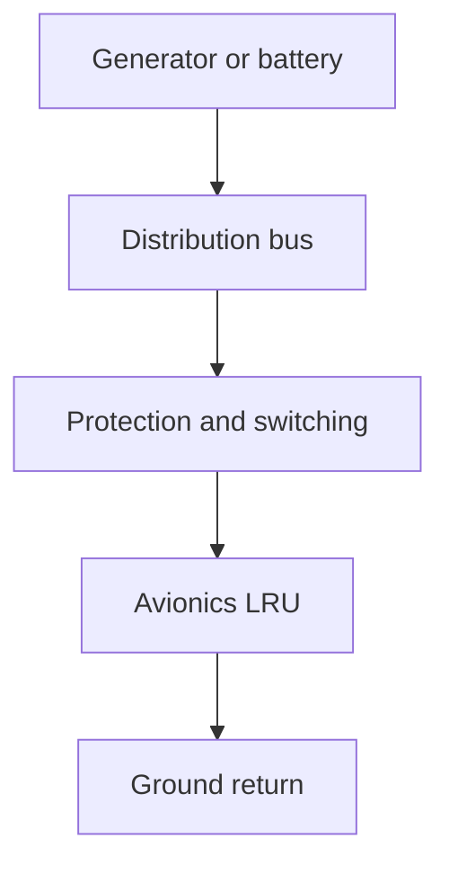

------------------------------------------------------------------------------------------------------------
# Avionics Electrical Power and Protection

[Operation](#operation)

[System Diagram](#system-diagram)

[Testing](#testing)

[More Reading](#more-reading)

------------------------------------------------------------------------------------------------------------

Corporate avionics depend on stable electrical power. Many business aircraft distribute nominal 28 VDC and some use 115 VAC at 400 Hz or variable-frequency AC; actual buses depend on aircraft design.

## Operation

**Sources and conversion:** Generators, batteries and external power feed distribution systems. Transformer rectifier units convert AC to DC; inverters convert DC to AC when required.

**Protection and distribution:** Circuit breakers, contactors, relays and solid-state power controllers protect and switch loads. Essential and standby buses may feed selected equipment after loss of normal sources.

**Ground return:** Voltage drop under load can cause a unit to reset even when open-circuit supply voltage appears normal.

## System Diagram

Conceptual signal flow; individual aircraft configurations vary.

## Testing

Investigate supply quality, voltage drop, ground integrity and load conditions using approved measurement points. Do not repeatedly reset tripped protection. Select meters and test methods suitable for the installed AC or DC system.

Training theory only; use applicable aircraft and equipment maintenance instructions for live tests and limits.

### More Reading

[FAA Aviation Maintenance Technician Handbook – Airframe, Chapter 9](https://www.faa.gov/regulations_policies/handbooks_manuals/aviation/FAA-H-8083-31B_Aviation_Maintenance_Technician_Handbook.pdf) — foundational reference; modern system details are supplementary training theory.

[Related lesson: Wiring and Connectors](../Wiring%20and%20Connectors/README.md)

[Back to DuncanU](../README.md)
