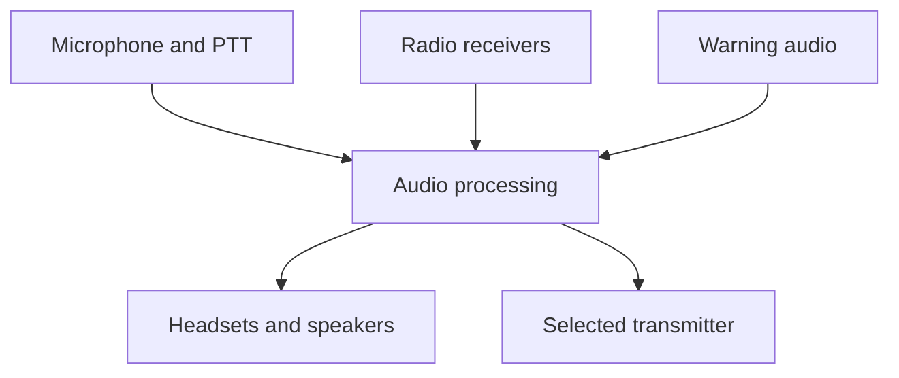

------------------------------------------------------------------------------------------------------------
# Digital Audio, Intercom and Passenger Address

[Operation](#operation)

[System Diagram](#system-diagram)

[Testing](#testing)

[More Reading](#more-reading)

------------------------------------------------------------------------------------------------------------

Corporate aircraft audio systems route microphone, receiver, warning and cabin audio. A crew member can monitor several sources while selecting a transmitter independently.

## Operation

**Audio control panels and remote audio units:** Select transmit and receive paths, control gain, and manage crew intercom. Digital systems may transport audio over a network while retaining analog headset and microphone interfaces.

**PTT and sidetone:** A push-to-talk input commands transmission; sidetone returns part of the transmit audio to the headset. PA and cabin call systems may share amplifiers or speakers. Emergency or fail-safe audio paths depend on the installation.

## System Diagram

Conceptual signal flow; individual aircraft configurations vary.

## Testing

Separate transmit keying from microphone audio and RF output. If one headset position fails, consider local wiring, jacks and channel configuration; if all positions fail, consider common audio processing or power. Noise may arise from shielding, ground paths or gain configuration.

Training theory only; use applicable aircraft and equipment maintenance instructions for live tests and limits.

### More Reading

[FAA Aviation Maintenance Technician Handbook – Airframe, Chapter 11](https://www.faa.gov/regulations_policies/handbooks_manuals/aviation/FAA-H-8083-31B_Aviation_Maintenance_Technician_Handbook.pdf) — foundational reference; modern system details are supplementary training theory.

[Related lesson: VHF COMM](../VHF%20COMM/README.md)

[Back to DuncanU](../README.md)
