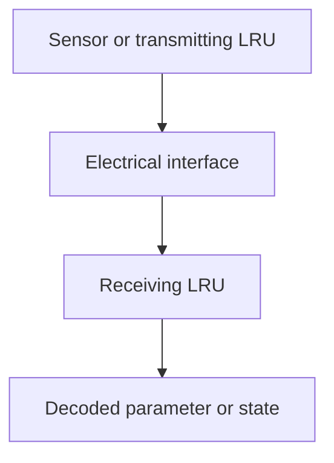

------------------------------------------------------------------------------------------------------------
# Serial, Analog, Discrete and Position Interfaces

[Operation](#operation)

[System Diagram](#system-diagram)

[Testing](#testing)

[More Reading](#more-reading)

------------------------------------------------------------------------------------------------------------

Aircraft avionics exchange information using serial links and electrical signals as well as packet networks. Understanding the interface type is essential before selecting test equipment.

## Operation

| Interface | Operating principle |
| --- | --- |
| RS-232 | Single-ended serial signaling |
| RS-422 | Differential serial signaling, generally one driver per pair |
| RS-485 | Differential signaling supporting multipoint configurations |
| Discrete | Open/ground or voltage state, depending on design |
| Analog | Continuous voltage, current or resistance |
| Resolver | Excited angular sensor with sine/cosine outputs |
| ARINC 708 | Specialized radar display data interface |
| ARINC 717 | Framed flight recording data interface |

Serial physical standards do not define every application protocol. A valid electrical signal may still contain the wrong message format. A resolver angle depends on relative signal amplitudes and phase/reference conventions.

## System Diagram

Conceptual signal flow; individual aircraft configurations vary.

## Testing

Use aircraft-specific signal definitions and appropriate high-impedance or isolated measurements. Never assume an open discrete is logic high, or inject a voltage into an unknown input. Verify reference ground, excitation and loading where applicable.

Training theory only; use applicable aircraft and equipment maintenance instructions for live tests and limits.

### More Reading

[FAA Aviation Maintenance Technician Handbook – Airframe, Chapter 11](https://www.faa.gov/regulations_policies/handbooks_manuals/aviation/FAA-H-8083-31B_Aviation_Maintenance_Technician_Handbook.pdf) — foundational reference; modern system details are supplementary training theory.

[Related lesson: ARINC 429](../ARINC%20429/README.md)

[Back to DuncanU](../README.md)
