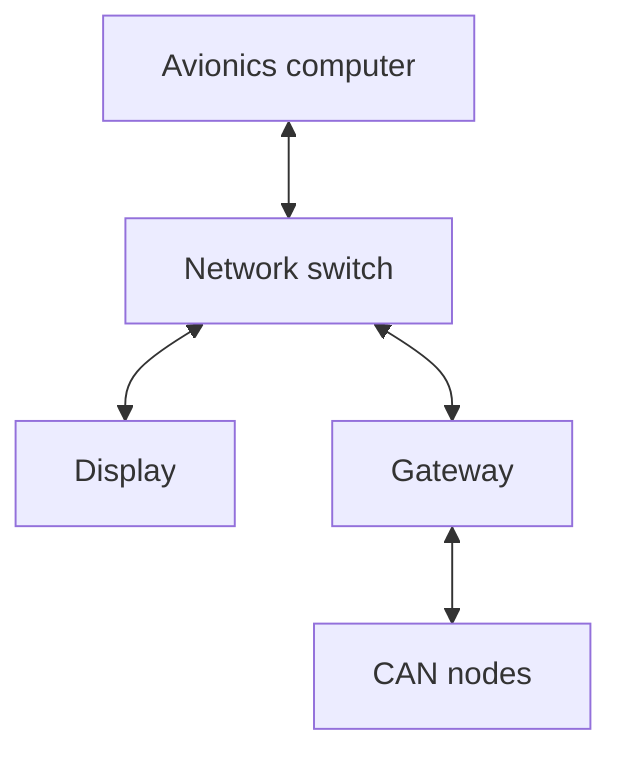

------------------------------------------------------------------------------------------------------------
# Avionics Ethernet, ARINC 664 and CAN Bus

[Operation](#operation)

[System Diagram](#system-diagram)

[Testing](#testing)

[More Reading](#more-reading)

------------------------------------------------------------------------------------------------------------

Integrated flight decks distribute digital information across switched or shared networks. Ethernet-based avionics networks, CAN and ARINC 429 solve different communication problems.

## Operation

**Ethernet:** Switches forward frames by MAC address; IP routing is a separate function. A physical link does not guarantee application connectivity.

**ARINC 664 Part 7 / AFDX:** Uses engineered virtual links, traffic constraints and commonly redundant networks to provide bounded communication behavior on applicable aircraft.

**CAN / ARINC 825:** A shared differential bus uses message identifiers and arbitration. Correct topology and termination are important; messages are broadcast to listening nodes.

**Fiber:** Some aircraft use optical links to reduce electromagnetic coupling; optical power and cleanliness matter.

## System Diagram

Conceptual signal flow; individual aircraft configurations vary.

## Testing

Distinguish link state, addressing, application traffic and data validity. On CAN, investigate topology, termination, short circuits and error state using approved tools; avoid attaching unapproved active devices to an aircraft network. Network A and B may be redundant paths rather than independent system functions.

Training theory only; use applicable aircraft and equipment maintenance instructions for live tests and limits.

### More Reading

[FAA Aviation Maintenance Technician Handbook – Airframe, Chapter 11](https://www.faa.gov/regulations_policies/handbooks_manuals/aviation/FAA-H-8083-31B_Aviation_Maintenance_Technician_Handbook.pdf) — foundational reference; modern system details are supplementary training theory.

[Related lesson: ARINC 429](../ARINC%20429/README.md)

[Back to DuncanU](../README.md)
