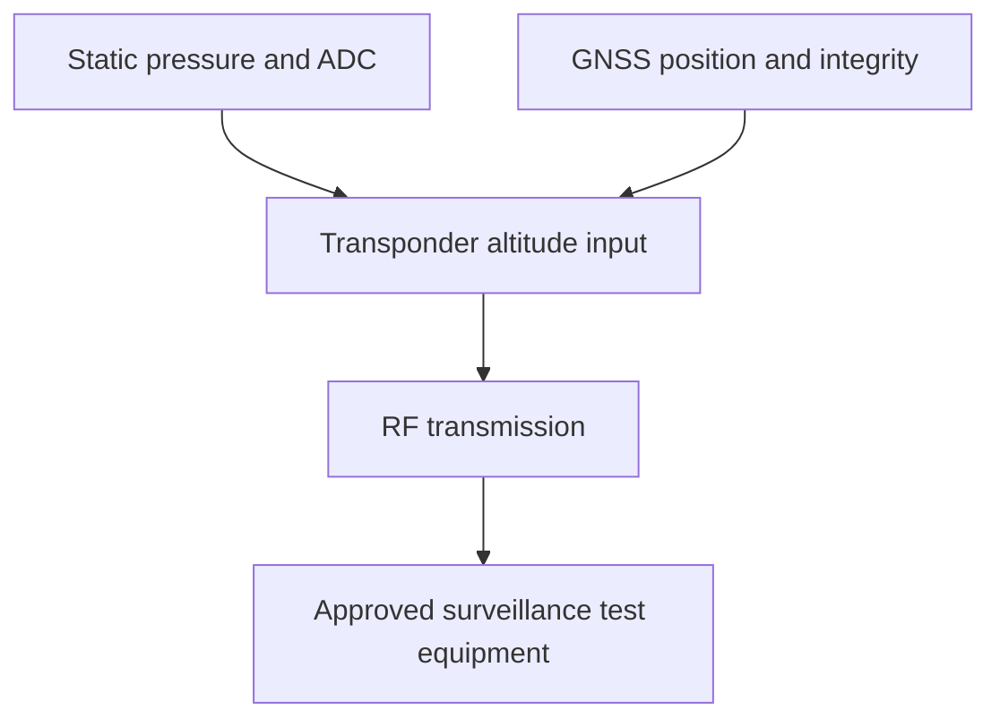

------------------------------------------------------------------------------------------------------------
# FAA Avionics Performance and Testing Requirements

**Core lesson: approximately 6 minutes.** Optional references are outside the timed lesson.

[Operation](#operation)

[System Diagram](#system-diagram)

[Testing](#testing)

[Knowledge Check](#knowledge-check)

[More Reading](#more-reading)

------------------------------------------------------------------------------------------------------------

This technical lesson introduces selected United States Federal Aviation Regulations (14 CFR) relevant to installed corporate aircraft avionics. It covers equipment performance and physical testing only, not paperwork, recordkeeping or administrative processes.

## Operation

| Requirement | Technical purpose |
| --- | --- |
| 91.411 and Part 43 Appendix E | Static system integrity, altimeter accuracy and installed altitude reporting correspondence |
| 91.413 and Part 43 Appendix F | Transponder performance, including applicable RF and reply characteristics |
| 91.225 and 91.227 | ADS-B Out equipment and broadcast performance in applicable airspace |

**Altitude and transponder testing:** Sections 91.411 and 91.413 establish 24-calendar-month intervals where applicable. Under 91.411, applicable static-system opening requires Appendix E(a) testing (except use of system drain and alternate static pressure valves); maintenance or installation where altitude correspondence error could be introduced requires Appendix E(c) testing under 91.411(a)(3) and 91.413(b), as applicable. Appendix E addresses static integrity, altimeter characteristics and integrated altitude reporting; Appendix F addresses transponder characteristics such as frequency, sensitivity and RF output, as applicable to the equipment.

**ADS-B performance:** Section 91.227 specifies broadcast content, position and velocity accuracy, integrity, design assurance and latency. A functioning Mode S reply is not proof that ADS-B Out meets those requirements; position source validity and transmitted message content also matter.

## System Diagram

Conceptual signal flow; aircraft installations vary.

## Testing

Use a suitable air data test set for applicable pneumatic and altitude checks, and approved surveillance test equipment for transponder and ADS-B measurements. Distinguish pressure-altitude accuracy, altitude correspondence and RF performance. Observe pressure limits, RF safety and test-mode restrictions. The regulation and aircraft-specific approved test instructions establish actual applicability, test points and limits; this overview is not a substitute for them.

## Knowledge Check

Does a satisfactory transponder RF output test establish correct ADS-B position and altitude reporting?

Answer

No. RF performance, altitude correspondence and ADS-B broadcast content and quality are separate checks.

### More Reading

[14 CFR 91.411 and 91.413 — current eCFR text](https://www.ecfr.gov/current/title-14/chapter-I/subchapter-F/part-91/subpart-E)

[14 CFR Part 43 Appendix E and F](https://www.ecfr.gov/current/title-14/chapter-I/subchapter-C/part-43)

[14 CFR 91.225](https://www.ecfr.gov/current/title-14/section-91.225)

[14 CFR 91.227](https://www.ecfr.gov/current/title-14/section-91.227)

[Related lesson: Transponder and ADS-B](../ATC/Quick%20Lesson.md)

[Back to DuncanU](../README.md)
