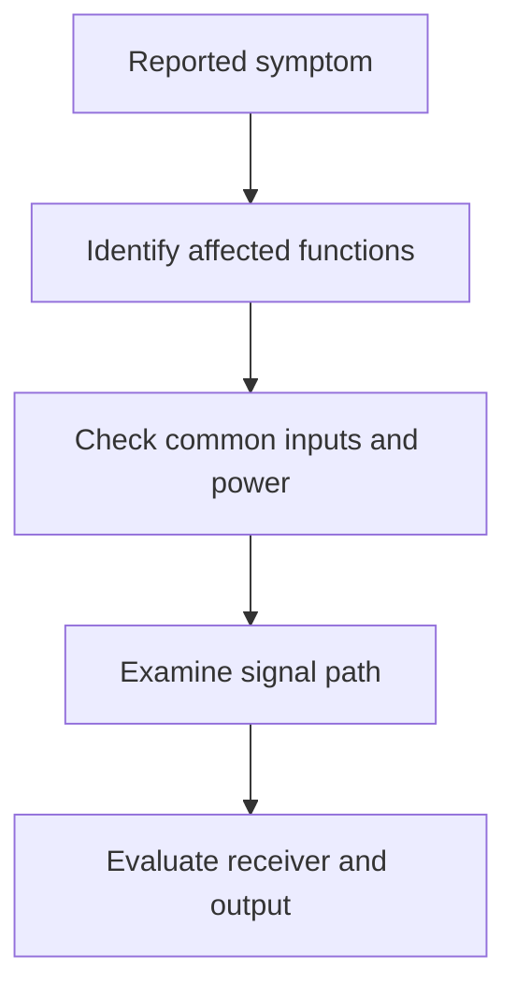

------------------------------------------------------------------------------------------------------------
# Avionics Testing and Fault Isolation

[Operation](#operation)

[System Diagram](#system-diagram)

[Testing](#testing)

[More Reading](#more-reading)

------------------------------------------------------------------------------------------------------------

Effective fault isolation separates source, signal path, receiving equipment and common dependencies before replacing components. Modern corporate aircraft require both electrical and digital/RF test capabilities.

## Operation

| Instrument | Typical purpose |
| --- | --- |
| Digital multimeter | Voltage, resistance and continuity within its rating |
| Oscilloscope | Time-domain waveform, noise and timing |
| Data bus analyzer | Decode and examine avionics messages |
| TDR | Locate impedance discontinuities |
| RF network analyzer | Frequency-dependent reflection and transmission |
| Air data test set | Controlled pneumatic simulation |
| Ramp test set | Approved surveillance or radio test functions |

**Fault isolation:** Distinguish an invalid source from a failed link or receiver. Use independent indications and known-good approved test methods. Apply ESD controls when handling sensitive components.

## System Diagram

Conceptual signal flow; individual aircraft configurations vary.

## Testing

A high-impedance meter can show voltage through a poor connection that fails under load. An oscilloscope ground clip can create an unintended ground path; use suitable isolated or differential probes. Use approved test modes and observe aircraft movement, RF and pneumatic safety precautions.

Training theory only; use applicable aircraft and equipment maintenance instructions for live tests and limits.

### More Reading

[FAA Aviation Maintenance Technician Handbook – Airframe, Chapter 9 and 11](https://www.faa.gov/regulations_policies/handbooks_manuals/aviation/FAA-H-8083-31B_Aviation_Maintenance_Technician_Handbook.pdf) — foundational reference; modern system details are supplementary training theory.

[Related lesson: Maintenance Systems](../Maintenance%20Systems/README.md)

[Back to DuncanU](../README.md)
