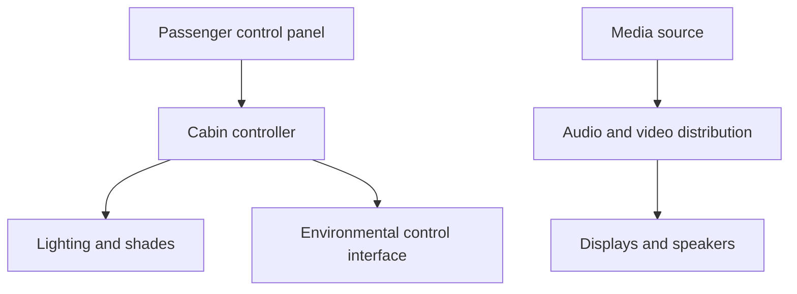

------------------------------------------------------------------------------------------------------------
# Cabin Management and Entertainment Systems

[Operation](#operation)

[System Diagram](#system-diagram)

[Testing](#testing)

[More Reading](#more-reading)

------------------------------------------------------------------------------------------------------------

A corporate cabin management system integrates lighting, temperature commands, shades, entertainment and passenger interfaces. Systems vary widely by aircraft and retrofit.

## Operation

**Distributed controllers:** Touchscreens and switches send commands to cabin processors or local modules. Controllers may drive lighting or relay outputs, while environmental systems retain their own control functions.

**Audio/video:** Sources feed distribution equipment, amplifiers and displays. HDMI, SDI, Ethernet and proprietary interfaces may be used depending on installation. Moving maps receive selected aircraft position data through an interface.

**Examples:** Collins Venue, Honeywell Ovation Select and Lufthansa Technik nice are examples of corporate cabin platforms; individual configurations differ.

## System Diagram

Conceptual signal flow; individual aircraft configurations vary.

## Testing

Separate a command failure from an output or load failure. If multiple zones are affected, investigate common power, network or processor functions. A single zone issue may originate in its local controller, wiring or load.

Training theory only; use applicable aircraft and equipment maintenance instructions for live tests and limits.

### More Reading

[FAA Aviation Maintenance Technician Handbook – Airframe, Chapter 9 and 11](https://www.faa.gov/regulations_policies/handbooks_manuals/aviation/FAA-H-8083-31B_Aviation_Maintenance_Technician_Handbook.pdf) — foundational reference; modern system details are supplementary training theory.

[Related lesson: Cabin Networking](../Cabin%20Networking/README.md)

[Back to DuncanU](../README.md)
