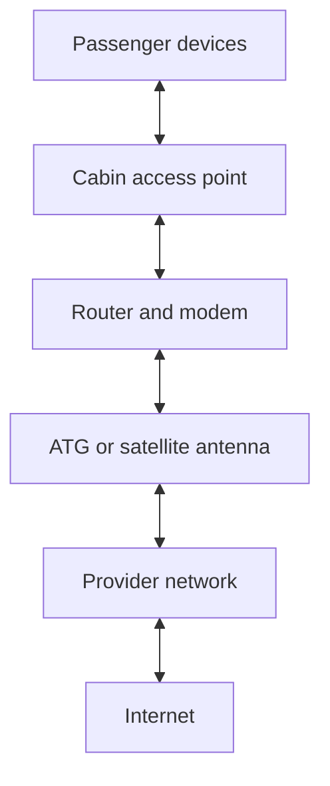

------------------------------------------------------------------------------------------------------------
# Cabin Networks and Modern Satellite Connectivity

[Operation](#operation)

[System Diagram](#system-diagram)

[Testing](#testing)

[More Reading](#more-reading)

[Videos](#videos)

------------------------------------------------------------------------------------------------------------

Corporate aircraft cabin networks connect passenger devices, cabin equipment and external connectivity services. Passenger network architecture is distinct from safety-critical avionics networks.

## Operation

**Local network:** Wi-Fi access points, Ethernet switches, routers, DHCP and DNS support passenger connectivity. A local connection does not prove that an external link is available.

**External links:** Air-to-ground, GEO and LEO satellite connectivity use different antenna and network arrangements. Electronically steered LEO antennas track moving satellites and manage handovers. Gogo Galileo and Starlink Aviation are examples of modern LEO offerings; Gogo AVANCE supports several ATG and satellite configurations.

**Network isolation:** Separation of passenger and aircraft-control domains is important. Aircraft information can be made available through controlled interfaces without exposing unrestricted access to avionics networks.

## System Diagram

Conceptual signal flow; individual aircraft configurations vary.

## Testing

Isolate device, wireless association, address assignment, DNS, routing, provider service and external RF link as different fault domains. Observe approved network security and RF safety provisions.

Training theory only; use applicable aircraft and equipment maintenance instructions for live tests and limits.

### More Reading

[FAA Aviation Maintenance Technician Handbook – Airframe, Chapter 11](https://www.faa.gov/regulations_policies/handbooks_manuals/aviation/FAA-H-8083-31B_Aviation_Maintenance_Technician_Handbook.pdf) — foundational reference; modern system details are supplementary training theory.

[Gogo AVANCE](https://www.gogoair.com/solutions/avance)

[Related lesson: GO GO](../GO%20GO/README.md)

[Related lesson: KA KU](../KA%20KU/README.md)

### Videos

[Eutelsat and Gogo: Powering OneWeb LEO for business aviation](https://www.youtube.com/watch?v=HtAlAwqE_EY) — manufacturer/customer overview, not a maintenance procedure.

[Back to DuncanU](../README.md)
