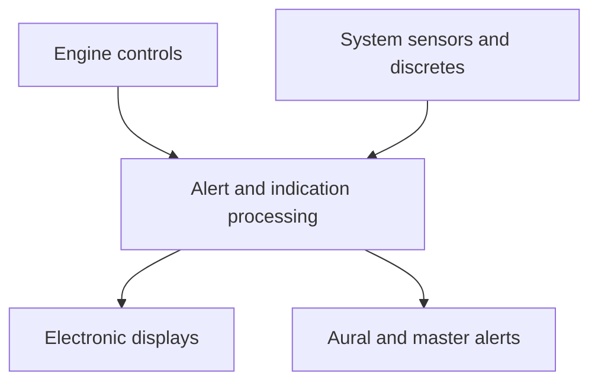

------------------------------------------------------------------------------------------------------------
# Engine Indications and Crew Alerting (EICAS / CAS)

[Operation](#operation)

[System Diagram](#system-diagram)

[Testing](#testing)

[More Reading](#more-reading)

------------------------------------------------------------------------------------------------------------

Modern corporate aircraft display engine parameters, system status and prioritized alerts through integrated electronic displays. EICAS combines engine indications with crew alerts; CAS denotes the alerting function, which can be integrated differently by platform.

## Operation

**Inputs:** Engine electronic controls, pressure and temperature sensors, switches and remote data concentrators provide system information.

**Processing:** Alert logic compares inputs with thresholds and conditions. Inhibits, priorities and latching depend on aircraft design. A sensor failure can generate an indication fault without a corresponding physical system failure.

**Outputs:** Display messages, master warning/caution indicators and aural alerts may be coordinated across multiple computers.

## System Diagram

Conceptual signal flow; individual aircraft configurations vary.

## Testing

Determine whether a message represents an actual abnormal system condition or invalid input. Compare independent sources and network status. Do not suppress a real warning or assume that a message identifies the failed LRU.

Training theory only; use applicable aircraft and equipment maintenance instructions for live tests and limits.

### More Reading

[FAA Aviation Maintenance Technician Handbook – Airframe, Chapter 10](https://www.faa.gov/regulations_policies/handbooks_manuals/aviation/FAA-H-8083-31B_Aviation_Maintenance_Technician_Handbook.pdf) — foundational reference; modern system details are supplementary training theory.

[Related lesson: EFIS](../EFIS/README.md)

[Back to DuncanU](../README.md)
