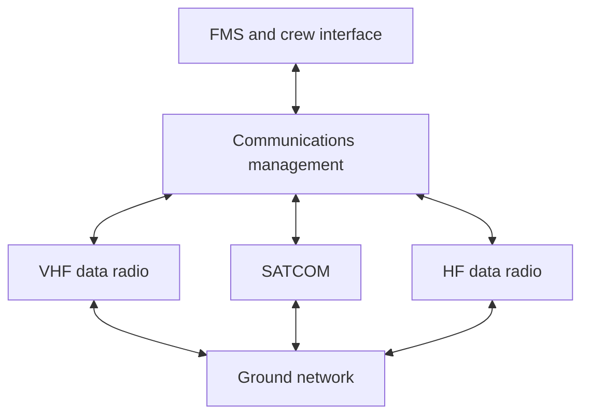

------------------------------------------------------------------------------------------------------------
# ACARS, CPDLC, FANS and SELCAL

[Operation](#operation)

[System Diagram](#system-diagram)

[Testing](#testing)

[More Reading](#more-reading)

------------------------------------------------------------------------------------------------------------

Corporate aircraft use digital air-ground communications for operational messages and air traffic services. ACARS is a messaging system; CPDLC is a controller-pilot messaging application and FANS 1/A commonly combines CPDLC and ADS-C capabilities.

## Operation

**Communications management:** A CMU or equivalent avionics function routes messages over supported VHF, satellite or HF data links. VDL Mode 2 is a digital VHF bearer; HFDL and SATCOM can support long-range service.

**ADS-C:** Contract-based reporting to a ground facility, distinct from broadcast ADS-B.

**SELCAL:** A ground station sends an assigned tone sequence over a voice radio; a decoder activates an aircraft alert. It is not a digital ATC messaging service.

## System Diagram

Conceptual signal flow; individual aircraft configurations vary.

## Testing

Distinguish radio availability from message routing, logon, application status and service availability. A successful voice call does not establish data-link functionality. Use ground test facilities or approved simulation rather than live operational ATC messages.

Training theory only; use applicable aircraft and equipment maintenance instructions for live tests and limits.

### More Reading

[FAA Aviation Maintenance Technician Handbook – Airframe, Chapter 11](https://www.faa.gov/regulations_policies/handbooks_manuals/aviation/FAA-H-8083-31B_Aviation_Maintenance_Technician_Handbook.pdf) — foundational reference; modern system details are supplementary training theory.

[Related lesson: Satcom](../Satcom/README.md)

[Back to DuncanU](../README.md)
