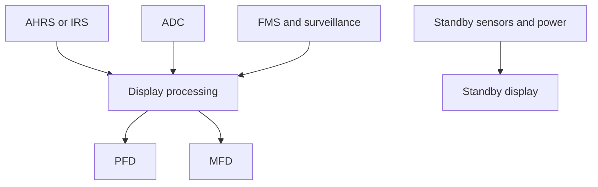

------------------------------------------------------------------------------------------------------------
# Electronic Flight Instrument Systems and Standby Instruments

[Operation](#operation)

[System Diagram](#system-diagram)

[Testing](#testing)

[More Reading](#more-reading)

------------------------------------------------------------------------------------------------------------

EFIS replaces separate mechanical indications with electronic primary flight and multifunction displays. An integrated standby display can provide an independent set of essential indications.

## Operation

**PFD:** Combines attitude, airspeed, altitude, heading, guidance and alert annunciations.

**MFD:** Presents navigation, weather, traffic, system synoptics and other information depending on installation.

**Display processing:** Symbols are generated from sensor and network data, not necessarily within the display itself. Reversionary modes can relocate information after a failure. Standby units may incorporate their own sensors and independent power.

## System Diagram

Conceptual signal flow; individual aircraft configurations vary.

## Testing

A blank display and invalid data flags are different failure modes. Compare information across displays, reversion modes and independent standby indications. Common fault domains include display power, dimming, video or network links, data source validity and processing modules.

Training theory only; use applicable aircraft and equipment maintenance instructions for live tests and limits.

### More Reading

[FAA Aviation Maintenance Technician Handbook – Airframe, Chapter 10](https://www.faa.gov/regulations_policies/handbooks_manuals/aviation/FAA-H-8083-31B_Aviation_Maintenance_Technician_Handbook.pdf) — foundational reference; modern system details are supplementary training theory.

[Related lesson: AHRS](../AHRS/README.md)

[Back to DuncanU](../README.md)
