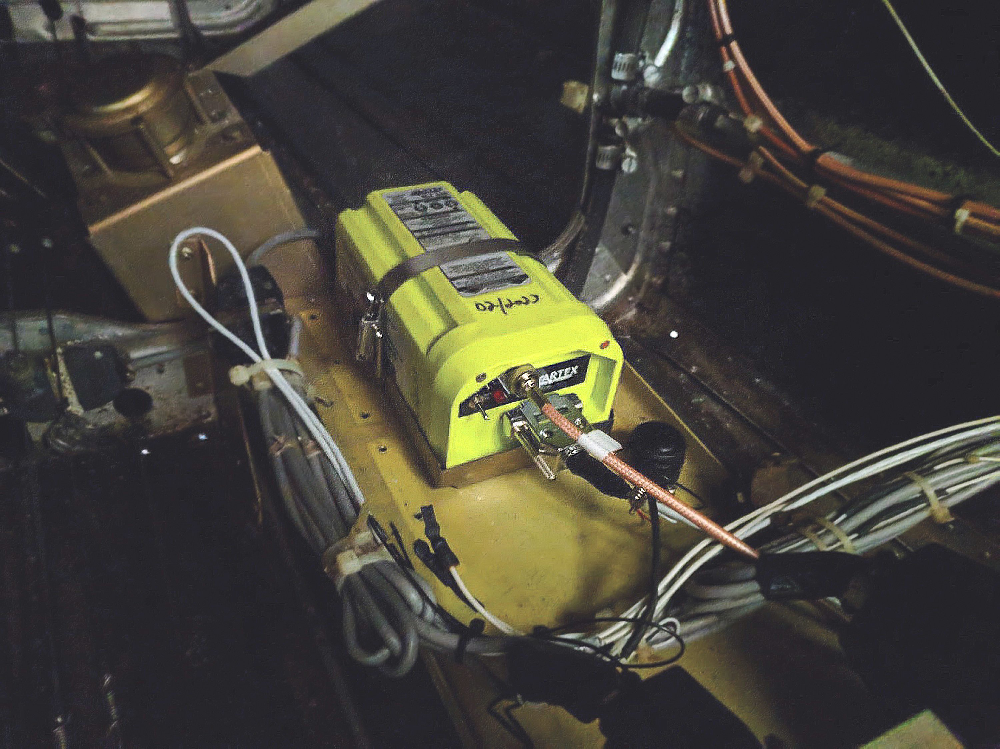
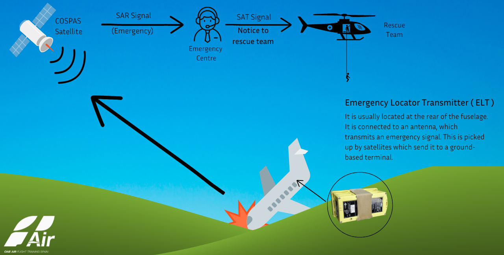
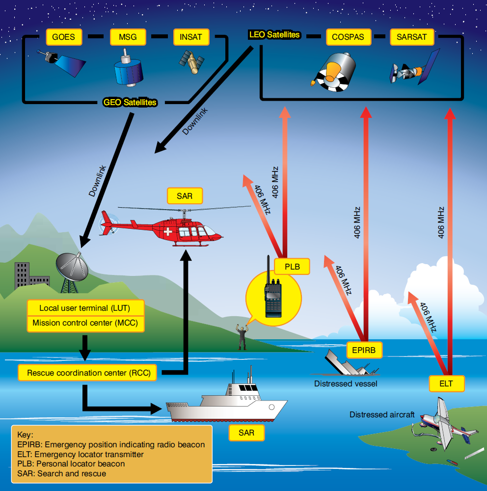
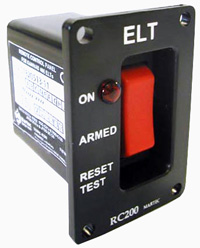

------------------------------------------------------------------------------------------------------------
# ELT 

[More Reading](https://github.com/flyn28261/DuncanU/blob/main/ELT/README.md#more-reading)

[Videos](https://github.com/flyn28261/DuncanU/blob/main/ELT/README.md#videos)

------------------------------------------------------------------------------------------------------------

A modern emergency locator transmitter (ELT) uses the 406 MHz distress-beacon band. Automatic fixed models can activate in a crash and may also be manually activated. Beacon frequency, transmission interval, power and endurance depend on the approved model and standard. Cospas-Sarsat uses LEO, MEO and GEO satellite systems to relay distress alerts.

The received signal is partially processed and stored in the satellites before being relayed to ground stations, known as [Local User Terminals (LUTs)](https://en.wikipedia.org/wiki/Local_User_Terminal). Further signal decoding occurs at the LUTs, notifying mission control centers (MCCs) for necessary search and rescue operations. Notably, maritime vessel emergency locating beacons (EPIRBs) and personal locator beacons (PLBs) also utilize this same system. In the United States, the COSPAS-SARSAT system is managed and operated by [NOAA](https://en.wikipedia.org/wiki/National_Oceanic_and_Atmospheric_Administration).

14 CFR 91.207 defines ELT applicability and exceptions, including provisions for Part 135 operations. Applicable inspections include installation, battery condition, controls, crash sensor and radiated signal checks. Use the manufacturer's self-test and approved test arrangements to avoid false distress alerts.

ELTs are typically situated as far aft in the fuselage of an aircraft as practicable, just forward of the empennage. The built-in G-force sensor aligns with the aircraft's longitudinal axis. For helicopters, ELTs may be located elsewhere on the airframe and are equipped with multidirectional activation devices. Proper installation, inspection, and maintenance of ELTs should follow the instructions provided by both the ELT and airframe manufacturers. By employing Doppler technology, the origin of the 406 MHz ELT signal can be calculated within a range of 2 to 5 kilometers. GNSS-equipped beacons can encode position from an internal or external source; this capability is not exclusive to second-generation beacons. The distress message includes encoded beacon identification; registration databases associate that identity with owner and contact information.

Fixed automatic, portable and other ELT configurations differ in installation and activation method. Many 406 MHz beacons also provide a 121.5 MHz homing signal. Satellite processing of analog 121.5/243 MHz distress alerts ended in 2009. The 121.5 MHz frequency remains in use for emergency communications and homing. Use only the approved self-test and model-specific test instructions; do not apply a legacy analog test procedure to a digital 406 MHz beacon.

### More Reading

[NOAA SARSAT — 406 MHz emergency distress beacons](https://www.sarsat.noaa.gov/emergency-406-beacons/)

[NOAA SARSAT — satellite systems](https://www.sarsat.noaa.gov/faqs/)

[14 CFR 91.207](https://www.ecfr.gov/current/title-14/section-91.207)

### Videos

[Aircraft ELT (emergency locator transmitter)](https://youtu.be/4vT8DBfdG_8?si=R4j2Q-E6F2AMBfqY)

