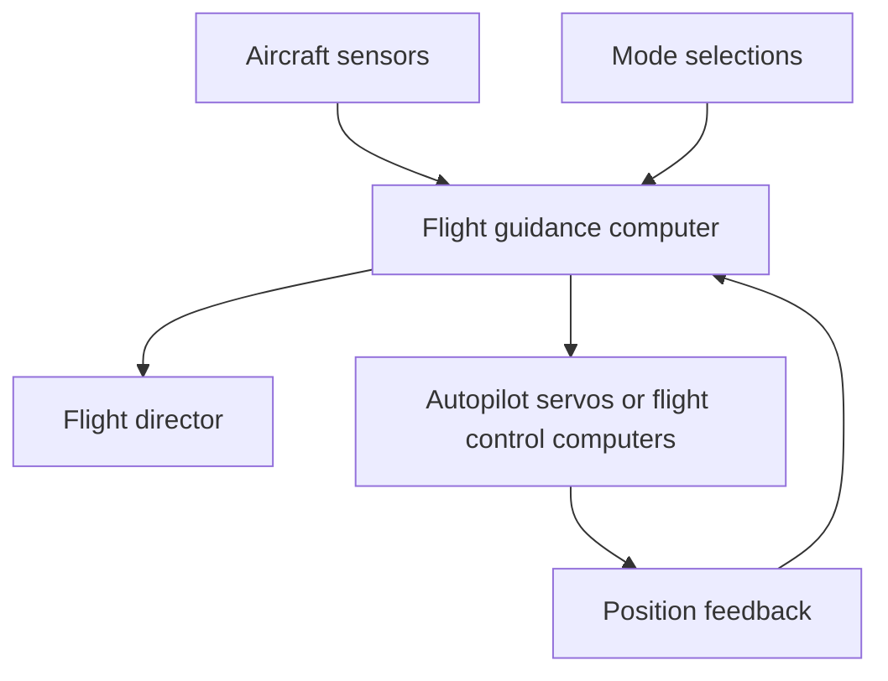

------------------------------------------------------------------------------------------------------------
# Digital Flight Guidance, Yaw Damper and Autothrottle

[Operation](#operation)

[System Diagram](#system-diagram)

[Testing](#testing)

[More Reading](#more-reading)

------------------------------------------------------------------------------------------------------------

Flight guidance combines selected targets with aircraft state to generate commands. A flight director presents commands; an autopilot can use them to control the aircraft. The yaw damper provides stability augmentation.

## Operation

**Guidance computer:** Uses attitude, air data, navigation and selected modes to calculate commands. Mode annunciations show active and armed modes.

**Servos and actuators:** Convert commands into movement; feedback and monitoring help detect disagreement. Fly-by-wire installations use electronic flight control computers and actuator feedback instead of conventional direct mechanical command paths.

**Autothrottle:** Where installed, adjusts thrust through throttle servos or engine-control interfaces. Emergency autoland integrates navigation, guidance, thrust and landing functions on equipped aircraft.

## System Diagram

Conceptual signal flow; individual aircraft configurations vary.

## Testing

Mode refusal can result from invalid navigation, air data or interlock inputs. A command indication alone does not establish servo operation. Treat control movement and powered actuators as hazards and use approved ground-test provisions.

Training theory only; use applicable aircraft and equipment maintenance instructions for live tests and limits.

### More Reading

[FAA Aviation Maintenance Technician Handbook – Airframe, Chapter 10](https://www.faa.gov/regulations_policies/handbooks_manuals/aviation/FAA-H-8083-31B_Aviation_Maintenance_Technician_Handbook.pdf) — foundational reference; modern system details are supplementary training theory.

[Related lesson: Autopilot](../Autopilot/README.md)

[Back to DuncanU](../README.md)
