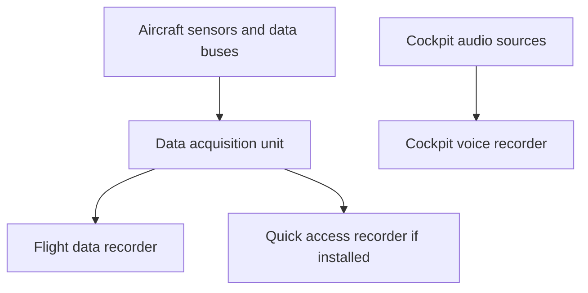

------------------------------------------------------------------------------------------------------------
# Flight Data and Cockpit Voice Recorders

[Operation](#operation)

[System Diagram](#system-diagram)

[Testing](#testing)

[More Reading](#more-reading)

------------------------------------------------------------------------------------------------------------

Flight data recorders store aircraft parameters; cockpit voice recorders store selected cockpit audio. Combined recorders may provide both functions. Quick access recorders collect data for easier retrieval without replacing the protected recorder.

## Operation

**FDAU/DFDAU:** Collects analog, discrete and digital inputs and organizes them into recording frames. ARINC 717 may carry framed data to an FDR; modern equipment can use other interfaces.

**CVR:** Audio sources can include crew microphones, audio panels and cockpit area microphones. Recorder status and test functions vary.

**ULB:** An underwater locator beacon uses an acoustic signal after immersion; it is not an ELT. Beacon frequency and endurance depend on the installed model.

## System Diagram

Conceptual signal flow; individual aircraft configurations vary.

## Testing

An invalid recorded parameter can originate upstream even when the recorder is healthy. Distinguish recorder power, input data, frame synchronization and retrieval errors. Use approved retrieval interfaces and protect recorded data from unintended alteration or erasure.

Training theory only; use applicable aircraft and equipment maintenance instructions for live tests and limits.

### More Reading

[FAA Aviation Maintenance Technician Handbook – Airframe, Chapter 10](https://www.faa.gov/regulations_policies/handbooks_manuals/aviation/FAA-H-8083-31B_Aviation_Maintenance_Technician_Handbook.pdf) — foundational reference; modern system details are supplementary training theory.

[Related lesson: ELT](../ELT/README.md)

[Back to DuncanU](../README.md)
