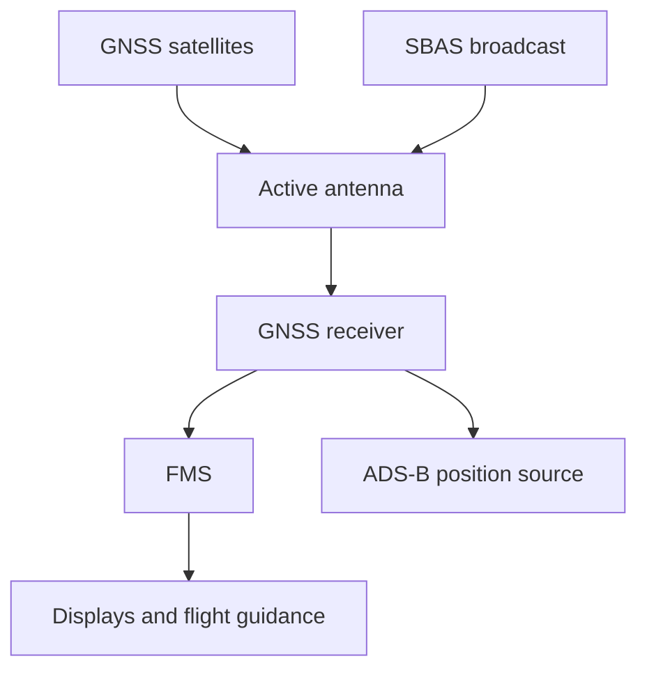

------------------------------------------------------------------------------------------------------------
# GPS / GNSS, WAAS and Performance-Based Navigation

[Operation](#operation)

[System Diagram](#system-diagram)

[Testing](#testing)

[More Reading](#more-reading)

------------------------------------------------------------------------------------------------------------

Satellite navigation is the primary position source in many modern business aircraft. A GNSS receiver derives position and time using pseudorange measurements from multiple satellites. GPS is one constellation; equipment may support additional constellations.

## Operation

**Receiver and antenna:** The L-band antenna often includes an amplifier powered through coax. GPS L1 is 1575.42 MHz; additional signals depend on receiver capability.

**WAAS / SBAS:** Ground monitoring stations estimate satellite and ionospheric errors. An augmentation broadcast provides corrections and integrity information. LPV uses supported SBAS approach guidance. RNAV permits navigation on desired paths; RNP adds onboard performance monitoring and alerting.

**Navigation databases:** The FMS uses coded waypoints and procedures; GNSS supplies position, not the procedure itself. A database mismatch is distinct from position loss.

## System Diagram

Conceptual signal flow; individual aircraft configurations vary.

## Testing

| Symptom | Possible fault domain |
| --- | --- |
| Both receivers lose satellites | Shared environment, interference or installation |
| One receiver has weak signals | Antenna, coax, supply or receiver |
| Position valid but approach unavailable | Augmentation, integrity, database or configuration |

Compare receiver status, satellite tracking and independent position sources. Do not radiate GNSS test signals into the surrounding airspace.

Training theory only; use applicable aircraft and equipment maintenance instructions for live tests and limits.

### More Reading

[FAA Aviation Maintenance Technician Handbook – Airframe, Chapter 11](https://www.faa.gov/regulations_policies/handbooks_manuals/aviation/FAA-H-8083-31B_Aviation_Maintenance_Technician_Handbook.pdf) — foundational reference; modern system details are supplementary training theory.

[FAA — Navigation aids, RNAV and WAAS](https://www.faa.gov/Air_traffic/Publications/atpubs/aip_html/part2_enr_section_4.1.html)

[Back to DuncanU](../README.md)
