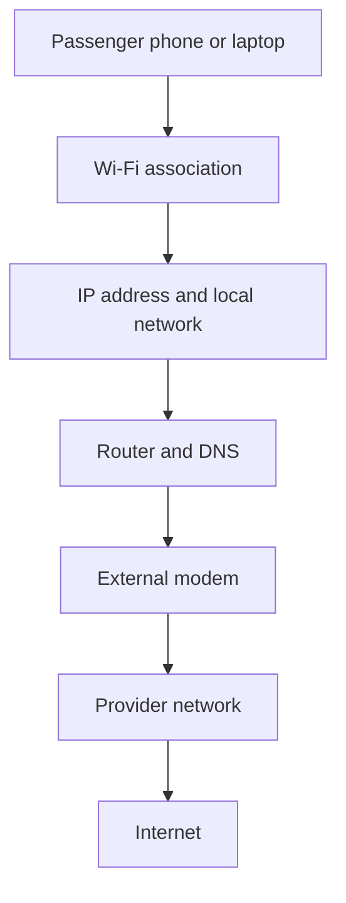

------------------------------------------------------------------------------------------------------------
# GO GO

[Radio Communication](#radio-communication)

[Antennas and Transmission Lines](#antennas-and-transmission-lines)

[System Components](#system-components)

[Aircraft Connectivity](#aircraft-connectivity)

[Network Architecture](#network-architecture)

[RF Installation Concepts](#rf-installation-concepts)

[Fault Isolation Examples](#fault-isolation-examples)

[Troubleshooting Concepts](#troubleshooting-concepts)

[More Reading](#more-reading)

[Videos](#videos)

------------------------------------------------------------------------------------------------------------

Gogo provides in-flight connectivity for business aircraft. Traditional air-to-ground (ATG) installations communicate with a network of terrestrial radio stations. The onboard equipment connects passenger devices to the internet through the aircraft cabin network. Coverage depends on the network, aircraft location, installed equipment and service plan. Satellite-capable configurations can provide connectivity beyond terrestrial coverage.

*The FAA handbook provides the radio and antenna fundamentals in this lesson. Gogo-specific ATG and cabin networking is supplemental material, not a dedicated FAA handbook lesson.*

## Radio Communication

Radio communication relies on electromagnetic energy carrying information between a transmitting station and a receiving station. The transmitter generates and modulates a carrier, while the receiving equipment selects the desired signal and recovers its information. A transceiver combines both functions. The antenna and transmission line form the interface between the electronic equipment and the radiated signal.

See FAA-H-8083-31B, Chapter 11, pages 11-29 through 11-36.

## Antennas and Transmission Lines

Antenna design determines how radio energy is radiated or received. Frequency, polarization and radiation pattern affect the suitability of the antenna for a particular service. Aircraft structure and mounting location can influence the installed radiation pattern. The transmission line must be appropriate for the radio and antenna, with compatible connectors and installation practices.

The FAA discusses equipment installation, shielding, bonding, interference and antenna installation in Chapter 11. These general principles apply to connectivity installations, but the approved equipment and aircraft documentation establishes the actual requirements.

See FAA-H-8083-31B, Chapter 11, pages 11-36 through 11-39 and 11-70 through 11-75.

## System Components

- **ATG antennas:** Provide the radio link to the ground network.
- **Connectivity LRU:** Contains the modem and network processing functions; the exact configuration varies by model.
- **Cabin wireless access points:** Provide Wi-Fi coverage for passenger devices; some systems integrate this function.
- **Aircraft interfaces:** Depending on the installation, supply power, configuration inputs and network connections.

## Aircraft Connectivity

The AVANCE platform supports several connectivity configurations. A cabin Wi-Fi connection alone does not establish that the aircraft has an active internet connection. ATG and satellite connectivity use different external links even when passengers connect to the same cabin network.

## Network Architecture

The cabin network and the external network perform different functions. A wireless access point provides the local radio connection to a passenger device. DHCP assigns network settings, DNS resolves names, and a router may perform network address translation (NAT). The external modem establishes a separate connection to the service provider. These functions may be integrated in a single LRU or distributed among several units.

| Interface | Purpose |
| --- | --- |
| Ethernet | Local data exchange between network equipment |
| RF coaxial cable | Carries RF between compatible radio equipment and antennas |
| Aircraft power and ground | Powers the installed equipment |
| Configuration or aircraft data inputs | Provide installation-specific information where required |

**ATG coverage and handover:** An aircraft travels between ground coverage areas. The modem and terrestrial network manage changes in serving radio sites. Terrain, altitude, network availability and antenna installation can influence connectivity. The AVANCE platform is available in different configurations; do not assume that an aircraft has a particular modem, antenna or service simply because it has AVANCE branding.

## RF Installation Concepts

An antenna converts electrical RF energy into electromagnetic waves and vice versa. Antenna polarization, ground plane, mounting location, cable attenuation and connector integrity influence performance. Cable loss normally increases with frequency and length. A mismatch in impedance reflects some RF energy rather than delivering it to the intended load.

**Return loss** describes the ratio of incident to reflected power in decibels. A larger positive return-loss value indicates less reflected power. VSWR is another expression of mismatch. Neither measurement alone proves that an installed antenna system is serviceable.

Never assume a generic cable impedance, allowable loss or antenna test limit; consult the applicable installation and maintenance documentation.

## Fault Isolation Examples

| Reported symptom | Possible fault domains |
| --- | --- |
| SSID not visible on multiple devices | Cabin access point, power, network configuration |
| Connected to Wi-Fi but no internet | IP configuration, router, modem, coverage or subscription |
| Only one passenger device affected | Device settings, authentication or compatibility |
| Intermittent connectivity by location | Coverage, handover, RF path or provider network |
| Unit unavailable or reporting faults | Power, communications, software or LRU fault |

These are hypotheses, not instructions to replace equipment. Capture aircraft configuration, flight conditions, fault messages and whether multiple devices were affected before consulting the approved fault isolation procedure.

## Troubleshooting Concepts

When investigating a reported connectivity issue, distinguish between cabin Wi-Fi availability, the external radio link and the service provider's network. Consider equipment status, network coverage, provisioning, power and antenna or cable condition. Record the operating conditions and fault indications. Use the applicable approved aircraft and equipment maintenance documentation for actual testing; this lesson does not establish test procedures or acceptance limits.

### More Reading

[FAA Aviation Maintenance Technician Handbook – Airframe (FAA-H-8083-31B), Chapter 11, pages 11-29–11-39 and 11-70–11-75](https://www.faa.gov/regulations_policies/handbooks_manuals/aviation/FAA-H-8083-31B_Aviation_Maintenance_Technician_Handbook.pdf)

[Gogo AVANCE platform overview](https://www.gogoair.com/resources/product-documentation/avance-overview)

[Gogo — AVANCE platform explained](https://www.gogoair.com/resources/blogs/avance-inflight-connectivity-and-entertainment-platform-explained)

[Gogo AVANCE](https://www.gogoair.com/solutions/avance)

[Gogo ATG Network](https://www.gogoair.com/solutions/atg-network)

[Duncan Aviation — Gogo Wi-Fi equipment information](https://www.duncanaviation.aero/intelligence/important-information-about-your-gogo-wi-fi-system)

[Related lesson: Satcom](../Satcom/README.md)

### Videos

[Communication and Navigation — AMT Handbook Chapter 11](https://www.youtube.com/watch?v=UBsLm71j8Xk) (third-party narration of an earlier handbook edition)

[Gogo DASH dealer training — aircraft and connectivity activation (Gogo)](https://www.youtube.com/watch?v=BJjVgR0W_9A)

This manufacturer video introduces provisioning and activation workflows. Use the current dealer documentation for actual activation.
