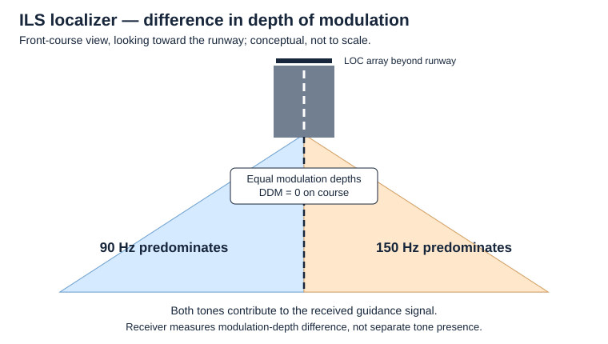

------------------------------------------------------------------------------------------------------------
# Instrument Landing System (ILS)

**Core lesson: approximately 5 minutes** (read, trace the signal path and answer the check). Optional references are not part of the timed lesson.

[Operation](#operation)

[Signal Flow](#signal-flow)

[Testing](#testing)

[Knowledge Check](#knowledge-check)

------------------------------------------------------------------------------------------------------------

ILS provides precision lateral and vertical approach guidance using ground radio signals received by aircraft navigation equipment.

## Operation

The localizer provides lateral deviation from the approach course; the glideslope provides vertical deviation. Receivers compare the depths of the 90 Hz and 150 Hz modulation components (DDM) to determine direction and magnitude of deviation. Localizer channels are within 108.10–111.95 MHz; paired glideslope channels are within 329.15–335.00 MHz. Marker beacons are legacy position aids and may be absent on modern approaches; DME or other approved fixes can supply position information.

## Signal Flow

```text
Localizer and glideslope antennas --> navigation receiver --> deviation and validity --> PFD / flight guidance.
```



## Testing

Separate lateral and vertical faults. Check selected approach source, RF path, receiver validity and display/flight-guidance interfaces. A valid localizer does not establish that the glideslope is valid.

Use applicable aircraft and equipment instructions for actual tests and limits.

## Knowledge Check

Which ILS signal provides vertical guidance?

<details><summary>Answer</summary>

The glideslope.

</details>

### More Reading — Optional

[Full existing lesson, images and resources](README.md)

[Back to DuncanU](../README.md)
