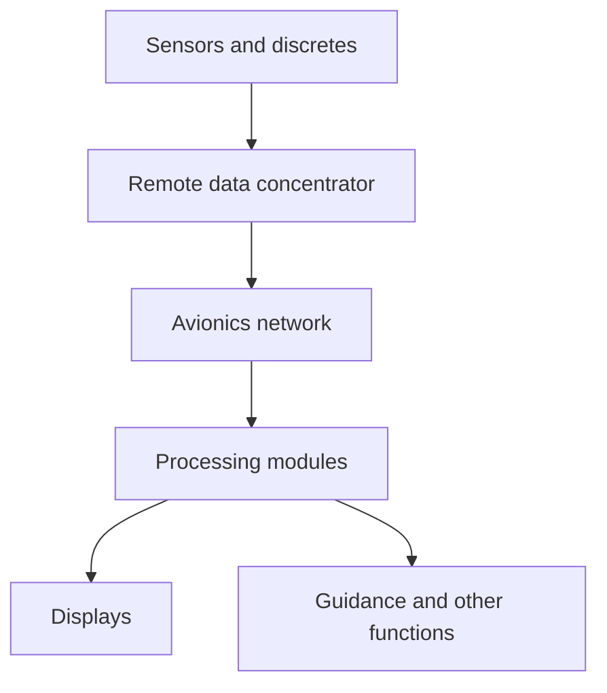

------------------------------------------------------------------------------------------------------------
# Integrated Flight Deck Architecture

[Operation](#operation)

[System Diagram](#system-diagram)

[Testing](#testing)

[More Reading](#more-reading)

------------------------------------------------------------------------------------------------------------

Modern corporate aircraft may use federated avionics, integrated modular avionics (IMA), or a mixture. Examples include Collins Pro Line 21/Fusion, Honeywell Primus Epic and Garmin integrated flight decks; architectures are not interchangeable.

## Operation

**Processing modules:** Shared computers can host multiple applications with partitioning to isolate their operation. Federated installations may have dedicated LRUs for each function.

**Remote data concentrators:** Collect electrical inputs near their sources and distribute converted data over a network. Gateways translate compatible data between interfaces.

**Configuration:** Aircraft-specific options, configuration modules and software compatibility determine available functions. A physically interchangeable LRU may require a different configuration.

**EFB and aircraft interface devices:** Can distribute selected aircraft data to permitted applications; isolation between domains is important.

## System Diagram

Conceptual signal flow; individual aircraft configurations vary.

## Testing

Several unrelated display flags may have one common source, power supply or network path. Identify the architecture before isolating an LRU. Software loading and configuration should use approved equipment and compatible software; incorrect configurations can affect multiple functions.

Training theory only; use applicable aircraft and equipment maintenance instructions for live tests and limits.

### More Reading

[FAA Aviation Maintenance Technician Handbook – Airframe, Chapter 10 and 11](https://www.faa.gov/regulations_policies/handbooks_manuals/aviation/FAA-H-8083-31B_Aviation_Maintenance_Technician_Handbook.pdf) — foundational reference; modern system details are supplementary training theory.

[Garmin — Integrated flight deck training resources](https://www.garmin.com/en-US/newsroom/press-release/aviation/garmin-announces-new-pilot-training-opportunities-through-spring-2022/)

[Back to DuncanU](../README.md)
