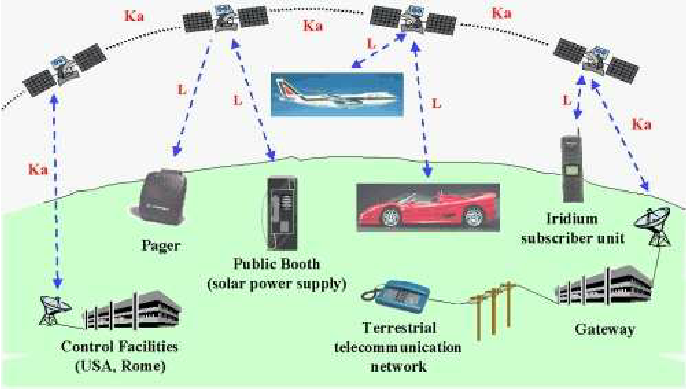
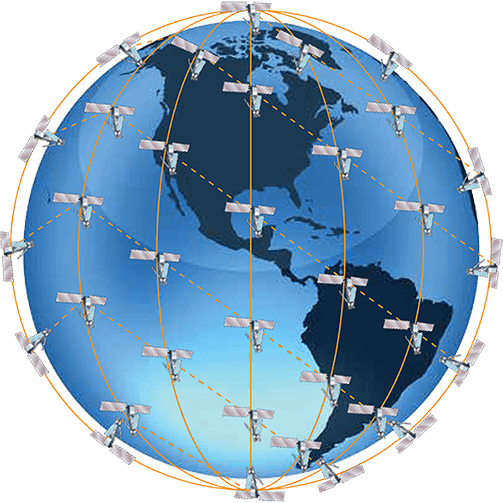

------------------------------------------------------------------------------------------------------------
# Iridium 

[Orbit](https://github.com/flyn28261/DuncanU/blob/main/Iridium/README.md#orbit)

[More Reading](https://github.com/flyn28261/DuncanU/blob/main/Iridium/README.md#more-reading)

[Videos](https://github.com/flyn28261/DuncanU/blob/main/Iridium/README.md#videos)

------------------------------------------------------------------------------------------------------------

Iridium provides L-band voice and data communications using a near-polar LEO satellite constellation. The nominal architecture uses 66 active satellites in six orbital planes at approximately 780 km altitude, with spares. Satellite-to-satellite Ka-band links support routing beyond individual ground gateway coverage. Aircraft terminal capabilities and available safety-service functions depend on installation and provider.

## Orbit

LEO satellites move relative to aircraft and ground stations. The network manages handovers as visibility changes. Near-polar orbits support high-latitude coverage. Antenna blockage, cable faults, terminal registration and network availability can still interrupt service. Iridium L-band aircraft links are distinct from Ka-band intersatellite links.

### More Reading

[Iridium — network overview](https://www.iridium.com/network/)

[Related lesson: SATCOM](../Satcom/Quick%20Lesson.md)

### Videos

[Iridium Milestone: Constellation Complete!](https://youtu.be/q2lVFvg69Fc?si=gqcxXBbwWmN5_wLp)
