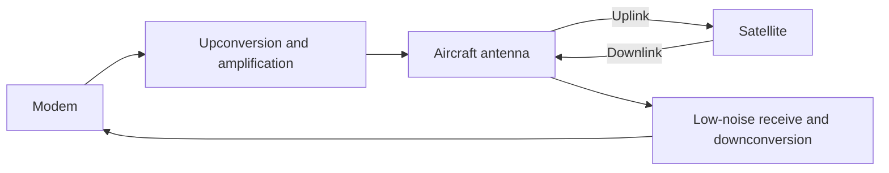
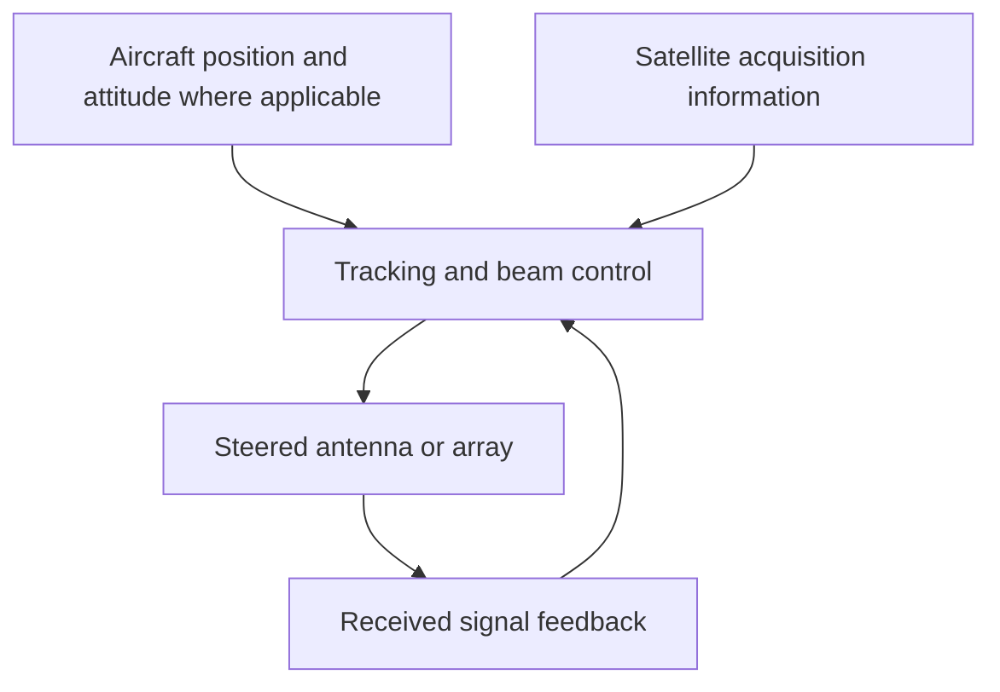

------------------------------------------------------------------------------------------------------------
# KA KU

[Radio Communication](#radio-communication)

[Antennas and Transmission Lines](#antennas-and-transmission-lines)

[Frequency Bands](#frequency-bands)

[System Components](#system-components)

[Aircraft Connectivity](#aircraft-connectivity)

[Satellite RF Signal Path](#satellite-rf-signal-path)

[Antenna Pointing and Polarization](#antenna-pointing-and-polarization)

[GEO and LEO Networks](#geo-and-leo-networks)

[Fault Isolation Examples](#fault-isolation-examples)

[Troubleshooting Concepts](#troubleshooting-concepts)

[More Reading](#more-reading)

[Videos](#videos)

------------------------------------------------------------------------------------------------------------

Ka-band and Ku-band satellite communication systems provide broadband connectivity to aircraft. The aircraft communicates with a satellite, which relays traffic through a network to ground infrastructure or other satellites. These systems can support passenger internet and other services, depending on the installation and provider.

*The FAA handbook provides the radio and antenna fundamentals in this lesson. Ka/Ku broadband satellite architecture is supplemental material, not a dedicated FAA handbook lesson.*

## Radio Communication

Radio communication relies on electromagnetic energy carrying information between a transmitting station and a receiving station. The transmitter generates and modulates a carrier, while the receiving equipment selects the desired signal and recovers its information. A transceiver combines both functions. The antenna and transmission line form the interface between the electronic equipment and the radiated signal.

See FAA-H-8083-31B, communication and navigation chapter.

## Antennas and Transmission Lines

Antenna design determines how radio energy is radiated or received. Frequency, polarization and radiation pattern affect the suitability of the antenna for a particular service. Aircraft structure and mounting location can influence the installed radiation pattern. The transmission line must be appropriate for the radio and antenna, with compatible connectors and installation practices.

The FAA discusses equipment installation, shielding, bonding, interference and antenna installation in Chapter 11. These general principles apply to connectivity installations, but the approved equipment and aircraft documentation establishes the actual requirements.

See the handbook's radio and antenna installation fundamentals.

## Frequency Bands

| Band | Common IEEE nominal range | Characteristics |
| --- | --- | --- |
| Ku | 12–18 GHz | Widely used for satellite broadband; available bandwidth and coverage depend on the network. |
| Ka | 26.5–40 GHz | Can offer substantial bandwidth; propagation is more sensitive to atmospheric attenuation, including rain. |

These are nominal IEEE radar-band definitions, not satellite service allocations. For example, satellite systems commonly called Ku may receive below 12 GHz, and systems called Ka may receive below 26.5 GHz. Actual satellite allocations and uplink/downlink frequencies vary.

## System Components

- **Satellite antenna:** Provides the radio link and may use mechanical or electronic beam steering.
- **Radome:** Where installed, protects the antenna while allowing RF energy to pass through.
- **Modem and RF electronics:** Process data and transmit or receive RF signals.
- **Antenna control functions:** Maintain the required pointing or beam tracking for the installed system.
- **Cabin network:** Distributes connectivity to passenger devices.

## Aircraft Connectivity

Geostationary (GEO) satellites appear nearly fixed relative to the ground, while low Earth orbit (LEO) satellites move across the sky and require network handovers. Frequency band and orbital architecture are separate characteristics.

## Satellite RF Signal Path

The uplink carries information from the aircraft toward the satellite; the downlink carries information toward the aircraft. The modem encodes digital data onto a carrier and recovers information from received signals. Depending on design, frequency conversion and amplification may be performed in separate LRUs or integrated with the antenna.

The transmit chain must provide sufficient usable RF power, and the receive chain must preserve weak incoming signals. Antenna gain, free-space path loss, cable loss, atmospheric loss and receiver noise all contribute to the link budget. Actual architecture and frequencies are installation-specific.

## Antenna Pointing and Polarization

A directional satellite antenna concentrates RF energy in a particular direction. Aircraft motion changes the relationship between antenna and satellite. Mechanically steered systems move an antenna assembly; electronically steered systems adjust the beam without requiring the same mechanical pointing mechanism. Some installations use aircraft position and attitude information to assist tracking.

Polarization describes the orientation or rotation of an electromagnetic wave's electric field. A polarization mismatch reduces received power. Radome material, coatings, moisture and damage may also change the RF characteristics. Approved radome repair and finish requirements are therefore important.

## GEO and LEO Networks

| Characteristic | GEO | LEO |
| --- | --- | --- |
| Orbit | Approximately 35,786 km above the equator | Typically hundreds to roughly 2,000 km above Earth |
| Apparent motion | Nearly stationary from a fixed ground location | Moves rapidly across the sky |
| Propagation delay | Higher due to longer path | Generally lower due to shorter path |
| Tracking | Aircraft motion still requires pointing compensation | Satellite motion and handovers also require management |

A lower orbit does not guarantee a particular speed or coverage. Congestion, routing, gateway availability and equipment capability also influence the passenger experience. Ka and Ku describe frequency bands, not orbit types.

## Fault Isolation Examples

| Reported symptom | Possible fault domains |
| --- | --- |
| Cabin Wi-Fi works but satellite link unavailable | Modem, provisioning, satellite acquisition, coverage |
| Link degrades in certain headings or attitudes | Antenna blockage, tracking inputs, installation geometry |
| Link degrades during precipitation | Atmospheric attenuation, radome condition, network margin |
| Antenna reports tracking fault | Antenna control, position/attitude inputs or antenna hardware |
| Only one device affected | Cabin network or device configuration |

These symptoms are not unique to the listed causes. RF transmitters and moving antenna assemblies can present hazards; observe approved maintenance safety precautions and never substitute this lesson for equipment-specific procedures.

## Troubleshooting Concepts

Distinguish cabin network faults from modem, antenna tracking, satellite coverage and service provisioning issues. Radome condition, RF path integrity, antenna blockage and weather can affect link performance. Follow applicable approved aircraft and equipment documentation, including RF exposure precautions, for all maintenance and testing.

### More Reading

[FAA Aviation Maintenance Technician Handbook – Airframe (FAA-H-8083-31B), communication and navigation chapter](https://www.faa.gov/regulations_policies/handbooks_manuals/aviation/FAA-H-8083-31B_Aviation_Maintenance_Technician_Handbook.pdf)

[Collins Aerospace — passenger connectivity and dual-band solutions](https://www.rtx.com/collinsaerospace/what-we-do/industries/business-aviation/flight-support-services/aircraft-connectivity-services/passenger-services)

[NBAA — connectivity technology overview](https://nbaa.org/news/business-aviation-insider/2022-05/airborne-connectivity-efficient-home-office-connections/)

[NBAA — Business Aircraft Connectivity](https://nbaa.org/aircraft-operations/communications-navigation-surveillance-cns/connectivity/special-report-business-aircraft-connectivity/)

[Related lesson: Satcom](../Satcom/README.md)

[Related lesson: Iridium](../Iridium/README.md)

### Videos

[Communication and Navigation — AMT Handbook Chapter 11](https://www.youtube.com/watch?v=UBsLm71j8Xk) (third-party narration of an earlier handbook edition)

[Viasat — The Secret Sauce Behind In-Flight Connectivity for Business Aviation](https://www.youtube.com/watch?v=opM8ktcHEk0)

Manufacturer overview of satellite network capacity and its relationship to airborne internet performance.
