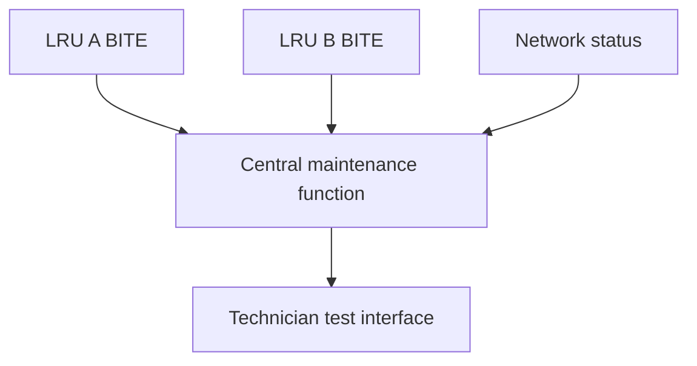

------------------------------------------------------------------------------------------------------------
# Central Maintenance Computers and BITE

[Operation](#operation)

[System Diagram](#system-diagram)

[Testing](#testing)

[More Reading](#more-reading)

------------------------------------------------------------------------------------------------------------

Modern corporate avionics frequently monitor their own health. Built-in test equipment detects selected faults; a central maintenance function can aggregate reports from multiple subsystems.

## Operation

**Power-up, continuous and initiated tests:** Different checks run at different times. Some are inhibited in flight or require specific ground conditions.

**Fault correlation:** One failed sensor or bus may produce secondary fault indications across many LRUs. A central maintenance computer can help identify common sources, but cannot guarantee root cause.

**Health monitoring:** Some installations transmit selected diagnostic data to off-aircraft services.

## System Diagram

Conceptual signal flow; individual aircraft configurations vary.

## Testing

Compare active and historical fault conditions, time correlation, supply voltage and network status. A no-fault result does not rule out intermittent wiring or RF defects. Do not repeatedly clear faults or initiate tests that move aircraft systems without appropriate safety provisions.

Training theory only; use applicable aircraft and equipment maintenance instructions for live tests and limits.

### More Reading

[FAA Aviation Maintenance Technician Handbook – Airframe, Chapter 11](https://www.faa.gov/regulations_policies/handbooks_manuals/aviation/FAA-H-8083-31B_Aviation_Maintenance_Technician_Handbook.pdf) — foundational reference; modern system details are supplementary training theory.

[Related lesson: EFIS](../EFIS/README.md)

[Back to DuncanU](../README.md)
