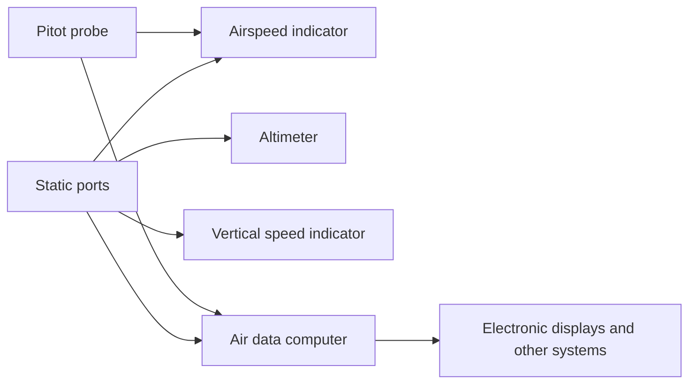

------------------------------------------------------------------------------------------------------------
# Pitot Static

[Operation](#operation)

[System Components](#system-components)

[Flight Instruments](#flight-instruments)

[Testing and Troubleshooting Concepts](#testing-and-troubleshooting-concepts)

[More Reading](#more-reading)

[Videos](#videos)

[Online Simulators](#online-simulators)

------------------------------------------------------------------------------------------------------------

## Operation

The pitot-static system supplies air pressure information to flight instruments and air data computers. A pitot probe senses total pressure, while static ports sense ambient atmospheric pressure. The difference between total and static pressure is used to determine indicated airspeed. Static pressure is also used to determine pressure altitude and vertical speed.

## System Components

- **Pitot probe:** Senses total pressure and may incorporate a heating element.
- **Static ports:** Sense ambient pressure at designated aircraft locations.
- **Tubing and fittings:** Carry pressure to instruments or air data equipment.
- **Air data computer (ADC):** Converts pressure and other inputs into air data outputs, depending on the installation.
- **Alternate static sources and drains:** May be provided depending on aircraft design.

## Flight Instruments

| Instrument | Pressure input | Function |
| --- | --- | --- |
| Airspeed indicator | Pitot and static | Indicates airspeed based on pressure difference. |
| Altimeter | Static | Indicates altitude based on atmospheric pressure and barometric setting. |
| Vertical speed indicator | Static | Indicates rate of climb or descent based on pressure change. |

This is a conceptual diagram showing possible mechanical and electronic consumers, not a specific aircraft plumbing arrangement.

## Testing and Troubleshooting Concepts

Leaks, blockages, moisture, damaged fittings and probe heating faults can affect system performance. Different blockage locations produce different indications, and redundant systems may disagree. Pressure integrity and instrument accuracy are distinct checks. Always use the applicable aircraft maintenance manual, approved test equipment instructions and regulatory requirements; do not apply generic pressure rates, limits or test sequences. In the United States, 14 CFR 91.411 and Part 43 Appendix E establish relevant requirements for altimeter and static pressure system inspections when applicable.

### More Reading

[FAA Aviation Maintenance Technician Handbook — Airframe](https://www.faa.gov/regulations_policies/handbooks_manuals/aviation/FAA-H-8083-31B_Aviation_Maintenance_Technician_Handbook.pdf)

[14 CFR 91.411](https://www.ecfr.gov/current/title-14/section-91.411)

[14 CFR Part 43 Appendix E](https://www.ecfr.gov/current/title-14/chapter-I/subchapter-C/part-43/appendix-Appendix%20E%20to%20Part%2043)

### Videos

[Pitot-Static Instruments](https://youtu.be/kdFGbUouE_4?si=z8Cmeo3flTI0oPC7)

### Online Simulators

[ Simulator](http://www.luizmonteiro.com/Learning_Pitot_Sim.aspx)
