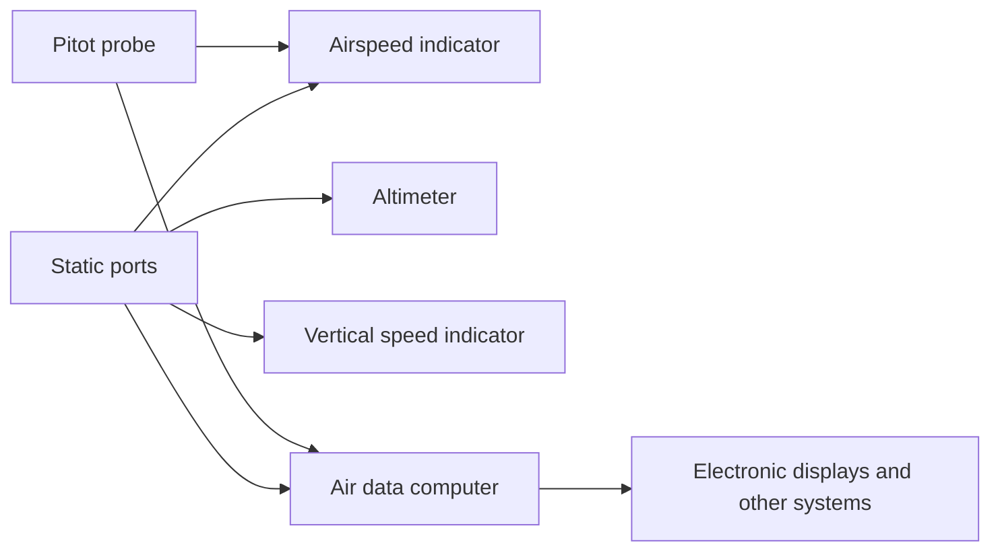
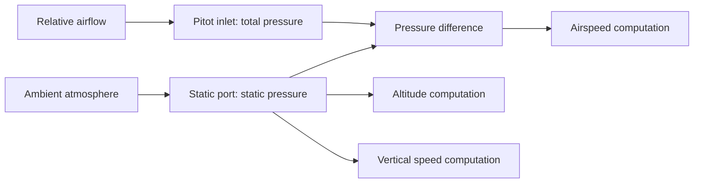
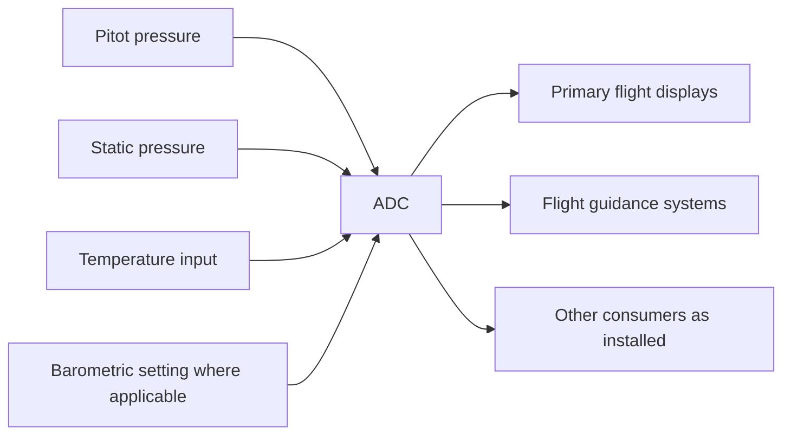
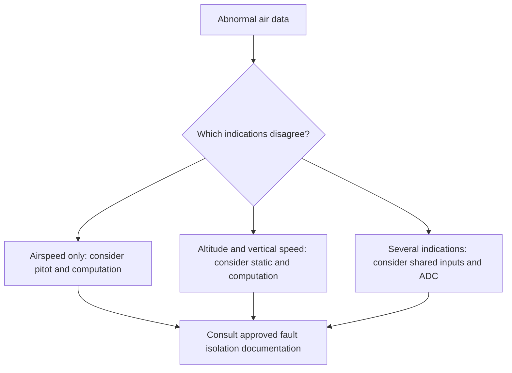

------------------------------------------------------------------------------------------------------------
# Pitot Static

[Pitot Tubes and Static Vents](#pitot-tubes-and-static-vents)

[System Components](#system-components)

[Flight Instruments](#flight-instruments)

[Pressure Theory](#pressure-theory)

[Air Data Computer](#air-data-computer)

[Blockage and Leak Indications](#blockage-and-leak-indications)

[Inspection and Regulatory Context](#inspection-and-regulatory-context)

[Testing and Troubleshooting Concepts](#testing-and-troubleshooting-concepts)

[More Reading](#more-reading)

[Videos](#videos)

[Online Simulators](#online-simulators)

------------------------------------------------------------------------------------------------------------

The pitot-static system supplies air pressure information to flight instruments and air data computers. A pitot probe senses total pressure, while static ports sense ambient atmospheric pressure. The difference between total and static pressure is used to determine indicated airspeed. Static pressure is also used to determine pressure altitude and vertical speed.

*Primary reference: FAA Aviation Maintenance Technician Handbook – Airframe, FAA-H-8083-31B (2023), Chapter 10. Additional corporate-aircraft examples are supplemental training material.*

## Pitot Tubes and Static Vents

A combined pressure head can contain separate chambers for total and static pressure. A forward-facing inlet collects total pressure, while small openings in the static chamber sense ambient pressure. Internal baffles and drains help manage contamination and moisture. Heating elements provide ice protection and can present a burn hazard on the ground.

On larger aircraft, separate flush static ports may be installed on opposite sides of the fuselage and connected to a common pressure source to reduce errors associated with airflow around the aircraft. Pressurized aircraft require suitable external alternate static sources rather than relying on cabin pressure. Independent pilot and copilot systems may have separate manifolds and drains.

See FAA-H-8083-31B, Chapter 10, pages 10-11 through 10-14, Figures 10-22 through 10-27.

## System Components

- **Pitot probe:** Senses total pressure and may incorporate a heating element.
- **Static ports:** Sense ambient pressure at designated aircraft locations.
- **Tubing and fittings:** Carry pressure to instruments or air data equipment.
- **Air data computer (ADC):** Converts pressure and other inputs into air data outputs, depending on the installation.
- **Alternate static sources and drains:** May be provided depending on aircraft design.

## Flight Instruments

| Instrument | Pressure input | Function |
| --- | --- | --- |
| Airspeed indicator | Pitot and static | Indicates airspeed based on pressure difference. |
| Altimeter | Static | Indicates altitude based on atmospheric pressure and barometric setting. |
| Vertical speed indicator | Static | Indicates rate of climb or descent based on pressure change. |

This is a conceptual diagram showing possible mechanical and electronic consumers, not a specific aircraft plumbing arrangement.

## Pressure Theory

- **Static pressure (Ps):** Ambient atmospheric pressure at the sensing location.
- **Total pressure (Pt):** Stagnation pressure sensed by the pitot probe.
- **Impact pressure (qc):** Difference between total and static pressure: qc = Pt − Ps.

At low Mach numbers, impact pressure approximately equals dynamic pressure, q = ½ρV², where ρ is air density and V is true airspeed. At higher Mach numbers, compressibility must be accounted for; impact and dynamic pressure are not generally identical.

The static port is positioned to minimize local airflow-induced error. Position error varies with aircraft configuration and flight conditions; calibrated airspeed accounts for instrument and position error in indicated airspeed.

## Air Data Computer

An ADC uses pressure transducers and computation to produce air data. Depending on the aircraft, it may also receive total air temperature, barometric setting and configuration inputs. Typical outputs include indicated or calibrated airspeed, Mach, pressure altitude, true airspeed and vertical speed. The precise output definitions and interfaces vary by installation.

| Output | Principle |
| --- | --- |
| Pressure altitude | Standard-atmosphere relationship to measured static pressure |
| Mach | Computed from pressure ratio with appropriate compressibility relationships |
| True airspeed | Air data and temperature used to determine speed relative to the surrounding air |
| Vertical speed | Derived from changes in static pressure over time |

Aircraft may use ARINC 429 or other approved data interfaces. A data bus fault can cause missing or invalid air data indications even when the pneumatic input is correct. Redundant ADCs may use independent pressure sources, shared inputs or comparator functions depending on the aircraft.

## Blockage and Leak Indications

The following examples assume conventional instruments, an otherwise functioning system and no alternate static source in use. Electronic systems may flag invalid data rather than display the same indications.

| Condition | Airspeed | Altitude | Vertical speed |
| --- | --- | --- | --- |
| Pitot inlet blocked, drain open | Tends toward zero | Normal | Normal |
| Pitot inlet and drain blocked, static clear | May increase in climb and decrease in descent at trapped total pressure | Normal | Normal |
| Static source blocked, pitot clear | Typically reads low above blockage altitude and high below it for comparable actual conditions | Frozen at blockage altitude | Returns to zero after transient |
| Leak | Depends on leak location and surrounding pressure | May be affected if static path leaks | May be affected if static path leaks |

A symptom can have multiple causes. Aircraft-specific pressure plumbing, cross-side comparisons and standby architecture must be understood before drawing conclusions.

## Inspection and Regulatory Context

Distinguish pneumatic leak testing, instrument or ADC accuracy verification, probe heat checks and digital data verification. They address different failure modes. The applicable aircraft maintenance manual specifies connection points, isolation requirements, pressure limits and restoration requirements. Protect connected instruments and pressure transducers from excessive differential pressure and unintended pressure changes.

In the United States, 14 CFR 91.411 applies to specified IFR operations in controlled airspace and includes a 24-calendar-month inspection requirement and certain additional tests following system opening or maintenance. Part 43 Appendix E defines applicable altimeter system test and inspection requirements. Transponder inspection requirements under 91.413 and Appendix F are separate, though installations can share altitude data. Consult current regulations and approved maintenance data for applicability and authorized personnel.

## Testing and Troubleshooting Concepts

Leaks, blockages, moisture, damaged fittings and probe heating faults can affect system performance. Different blockage locations produce different indications, and redundant systems may disagree. Pressure integrity and instrument accuracy are distinct checks. Always use the applicable aircraft maintenance manual, approved test equipment instructions and regulatory requirements; do not apply generic pressure rates, limits or test sequences. In the United States, 14 CFR 91.411 and Part 43 Appendix E establish relevant requirements for altimeter and static pressure system inspections when applicable.

### More Reading

[FAA Aviation Maintenance Technician Handbook – Airframe (FAA-H-8083-31B), Chapter 10, pages 10-11–10-24 and 10-80–10-81](https://www.faa.gov/regulations_policies/handbooks_manuals/aviation/FAA-H-8083-31B_Aviation_Maintenance_Technician_Handbook.pdf)

[FAA — Pilot's Handbook of Aeronautical Knowledge](https://www.faa.gov/regulations_policies/handbooks_manuals/aviation/phak)

[FAA — Aviation handbooks and manuals](https://www.faa.gov/regulations_policies/handbooks_manuals/aviation)

[FAA Aviation Maintenance Technician Handbook — Airframe](https://www.faa.gov/regulations_policies/handbooks_manuals/aviation/FAA-H-8083-31B_Aviation_Maintenance_Technician_Handbook.pdf)

[14 CFR 91.411](https://www.ecfr.gov/current/title-14/section-91.411)

[14 CFR Part 43 Appendix E](https://www.ecfr.gov/current/title-14/chapter-I/subchapter-C/part-43/appendix-Appendix%20E%20to%20Part%2043)

### Videos

[Aircraft Instrument Systems — AMT Handbook Chapter 10](https://www.youtube.com/watch?v=8pt327wfR94) (third-party narration of an earlier handbook edition)

[AeroGuard — Understanding Pitot-Static System and Flight Instruments (embedded video)](https://www.flyaeroguard.com/learning-center/pitot-static-system/)

[Test Pilots — instrumentation and air data explainer videos](https://www.testpilots.aero/instrumentation-videos)

[Original Pitot-Static Instruments video](https://youtu.be/kdFGbUouE_4?si=z8Cmeo3flTI0oPC7)

### Online Simulators

[ Simulator](http://www.luizmonteiro.com/Learning_Pitot_Sim.aspx)
