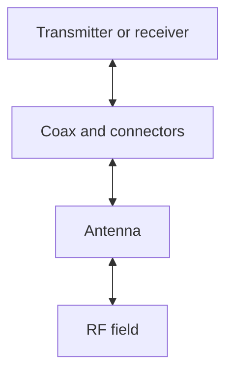

------------------------------------------------------------------------------------------------------------
# Antennas, Coaxial Cable and RF Testing

[Operation](#operation)

[System Diagram](#system-diagram)

[Testing](#testing)

[More Reading](#more-reading)

------------------------------------------------------------------------------------------------------------

Antennas convert electrical RF energy into radiated energy and back. Transmission lines carry RF between radios and antennas. In business jets, installations range from VHF communications to microwave weather radar and satellite systems.

## Operation

**Frequency and polarization:** Wavelength is inversely proportional to frequency. Antenna size, orientation and ground plane influence performance.

**Transmission lines:** Characteristic impedance and attenuation are frequency-dependent. Many RF systems use 50-ohm coax, but installed specifications control. Mismatch causes reflected power; VSWR and return loss express that mismatch differently.

For reflection coefficient magnitude r, VSWR = (1+r)/(1-r), and positive return loss = -20 log10(r). A matched lossy cable can still show acceptable return loss despite poor transmission.

## System Diagram

Conceptual signal flow; individual aircraft configurations vary.

## Testing

DC continuity does not establish RF performance. Depending on the approved test, a cable analyzer, network analyzer or TDR can distinguish reflections, loss and fault location. Isolate powered active antennas and sensitive RF electronics before connecting instruments as required.

Training theory only; use applicable aircraft and equipment maintenance instructions for live tests and limits.

### More Reading

[FAA Aviation Maintenance Technician Handbook – Airframe, Chapter 11](https://www.faa.gov/regulations_policies/handbooks_manuals/aviation/FAA-H-8083-31B_Aviation_Maintenance_Technician_Handbook.pdf) — foundational reference; modern system details are supplementary training theory.

[Related lesson: VHF COMM](../VHF%20COMM/README.md)

[Back to DuncanU](../README.md)
