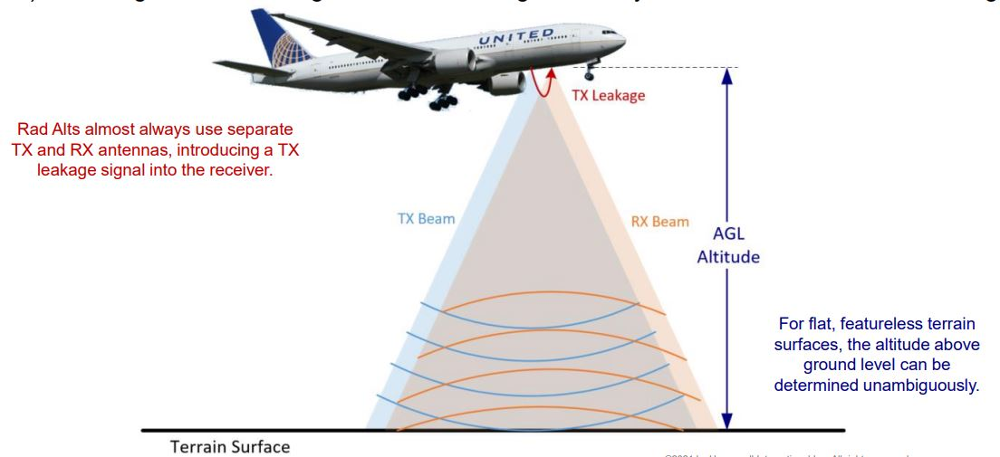

------------------------------------------------------------------------------------------------------------
# Radar Altimeter 

[More Reading](#more-reading)

[Videos](#videos)

------------------------------------------------------------------------------------------------------------

A [radio altimeter](https://en.wikipedia.org/wiki/Radio_altimeter), also known as a radar altimeter, is employed to gauge the distance between the aircraft and the ground directly beneath it. It is typically a low-range sensor used by landing, terrain warning and flight-control functions; operating range varies by model. It supplies radio height to dependent systems and may support applicable decision-height indications. It features an adjustable altitude marker that triggers a visual or audible alert to the pilot once the aircraft reaches that specific altitude. Typically, if the decision height is reached and the runway is not visible, the pilot will opt to abort the landing.

Civil radar altimeters operate in the 4.2–4.4 GHz band. Many use frequency-modulated continuous wave (FMCW): a frequency sweep is transmitted toward the surface and the delayed return is compared with the current transmit frequency. The beat frequency is proportional to range for a known sweep slope. Sweep bandwidth, antenna arrangement and usable range vary by equipment. Other ranging designs also exist. Antenna placement, coax loss, surface reflectivity and RF interference can affect the measurement.

In comparison to an air pressure altimeter, a radar altimeter provides more precise and immediate information about altitude above ground level (AGL) at lower elevations. The transceiver is typically situated in a location separate from the indicator. Modern multifunctional and glass cockpit displays often incorporate awareness of decision height from the radar altimeter as a digital value displayed on the screen, along with an indicator, light, or color change to signify when that altitude is reached. In larger aircraft, information from the radio altimeter may be integrated into a [Ground Proximity Warning System (GPWS)](https://en.wikipedia.org/wiki/Ground_proximity_warning_system) that audibly notifies the crew of potentially hazardous proximity to the terrain beneath the aircraft. Decision height is a selected threshold; radio height is the measured quantity, and modern display presentation varies.

## More Reading

[FAA AC 20-199 — Installation of an airborne low-range radio altimeter](https://www.faa.gov/regulations_policies/advisory_circulars/index.cfm/go/document.information/documentID/1044196)

[Radar Altimeter Overview of Design and Performance](https://github.com/flyn28261/DuncanU/blob/main/Radar%20Altimeter/Radar-Altimeter-Overview-of-Design-and-Performance.pdf)

## Videos

[How a Radio Altimeter Work](https://youtu.be/CGSK8wUJRqQ?si=VmdcOA1hC5fxlrPv)
