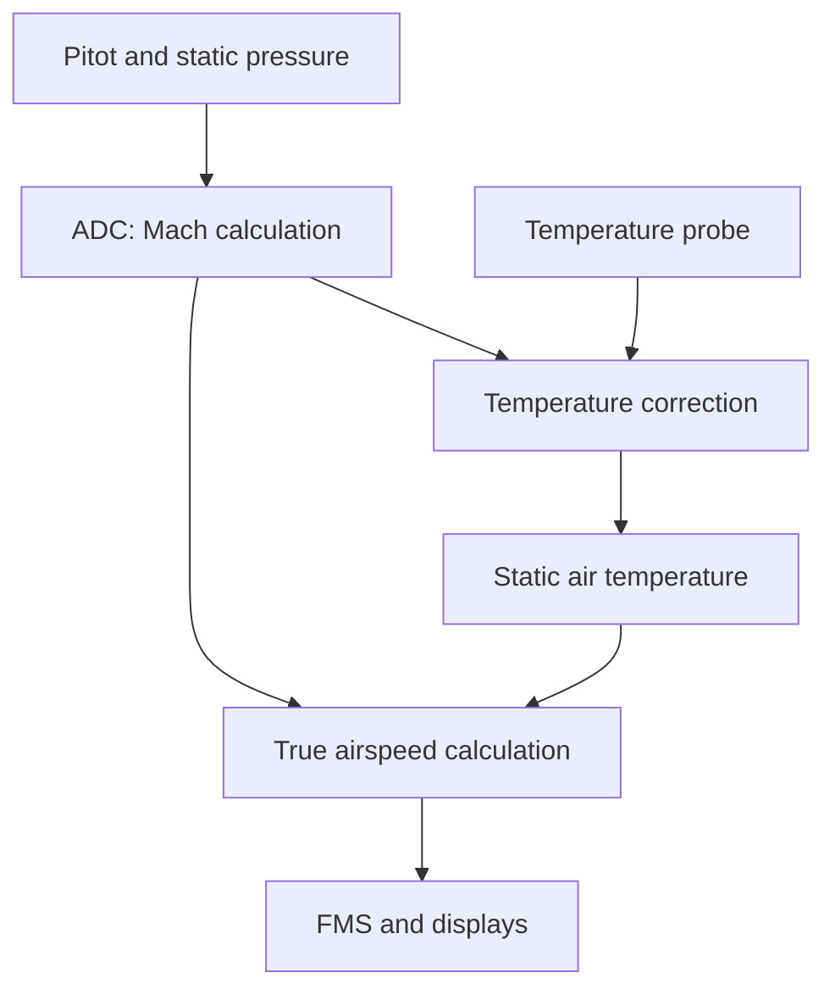

------------------------------------------------------------------------------------------------------------
# Static Air Temperature, Total Air Temperature and True Airspeed

**Core lesson: approximately 6 minutes.** Optional references are outside the timed lesson.

[Operation](#operation)

[System Diagram](#system-diagram)

[Testing](#testing)

[Knowledge Check](#knowledge-check)

[More Reading](#more-reading)

------------------------------------------------------------------------------------------------------------

Modern corporate aircraft use air data computers (ADC) or integrated air data functions to calculate air temperature and true airspeed. Temperature information is important for airspeed conversion and aircraft performance calculations.

## Operation

| Parameter | Meaning |
| --- | --- |
| SAT | Static air temperature: undisturbed outside air temperature |
| TAT | Total air temperature: temperature after airflow deceleration, including ram rise |
| IAS | Indicated airspeed: indicated pressure-based speed |
| CAS | Calibrated airspeed: IAS corrected for instrument and position error |
| TAS | True airspeed: actual speed relative to the surrounding air |

**Temperature probe:** A resistance temperature sensor or other installed sensing element measures recovered air temperature. Probe heating can provide ice protection; the sensing and heater circuits are distinct. The ADC accounts for probe recovery characteristics as applicable.

**Ram rise:** At higher Mach numbers, decelerating airflow raises the sensed temperature. For ideal full recovery in air, TAT = SAT × (1 + 0.2 × M²), using absolute temperature in kelvin. At Mach 0.80, a SAT of 223.15 K (−50 °C) gives an ideal TAT of about 251.7 K (−21.4 °C). Actual probe corrections are equipment-specific.

**TAS:** For ideal air, TAS = Mach × speed of sound at SAT. At Mach 0.80 and SAT −50 °C, TAS is approximately 466 knots. Wind affects ground speed, not TAS. The ADC derives Mach from pressure measurements and computes TAS using temperature information. These equations illustrate theory, not calibration limits.

## System Diagram

Conceptual signal flow; aircraft installations vary.

## Testing

| Symptom | Possible fault domain |
| --- | --- |
| Implausible TAT on one channel | Probe, sensing circuit or ADC |
| Correct Mach but erroneous TAS | Temperature input or conversion |
| Temperature missing after replacement | Interface, configuration or wiring |

Compare independent channels and parameter validity. A probe-heater fault does not by itself prove a failed temperature sensor. Use the approved electrical test method and avoid overheating the probe on the ground.

## Knowledge Check

Why can TAS be wrong when indicated airspeed and Mach appear normal?

Answer

TAS also depends on static air temperature; a faulty temperature input or correction can affect TAS without producing the same error in pressure-derived values.

### More Reading

[FAA AMT Handbook – Airframe, Chapter 10: Airspeed Indicators (10-23) and Total Air Temperature Measurement (10-40)](https://www.faa.gov/regulations_policies/handbooks_manuals/aviation/FAA-H-8083-31B_Aviation_Maintenance_Technician_Handbook.pdf)

[Related lesson: ADC](../Air%20Data%20Computer/README.md)

[Back to DuncanU](../README.md)
