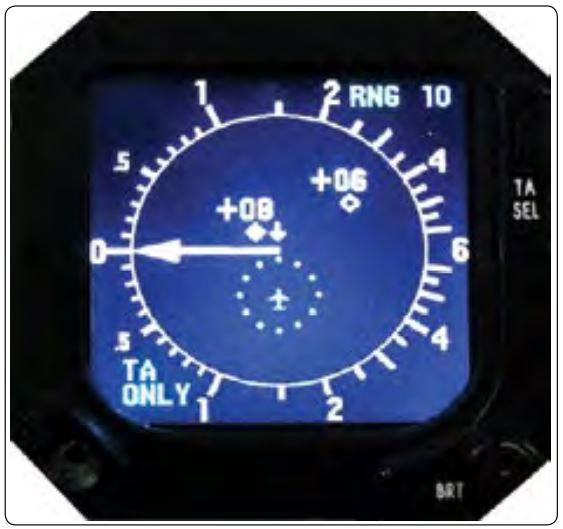
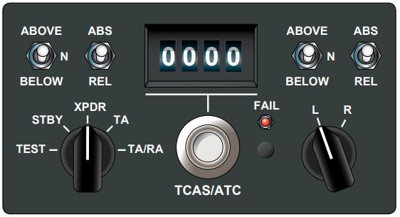
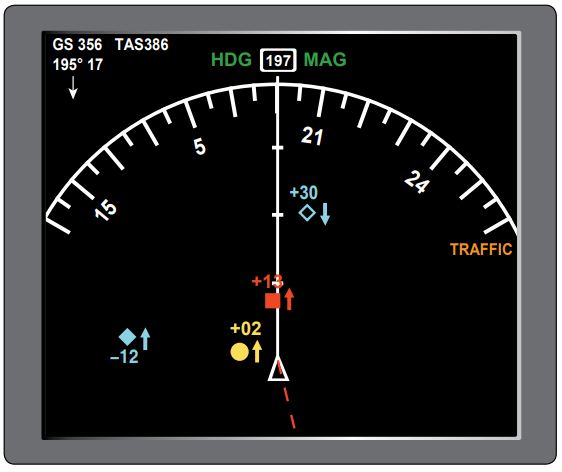
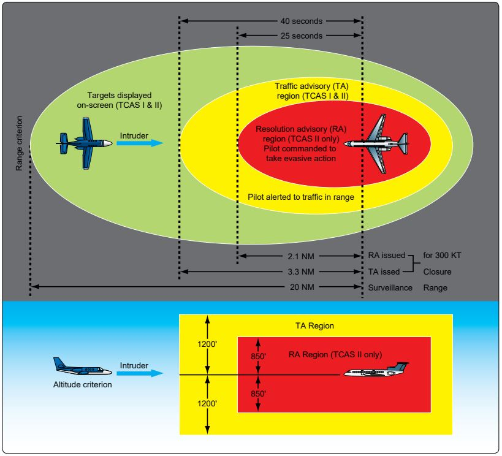
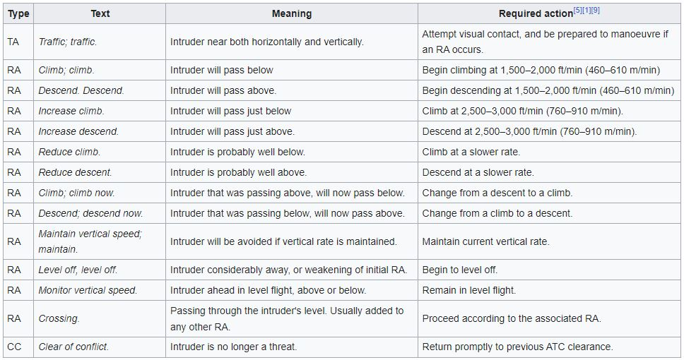

--------------------------------------------------------------------------------------------
# Traffic Collision Avoidance Systems (TCAS) 
--------------------------------------------------------------------------------------------

--------------------------------------------------------------------------------------------

Traffic collision avoidance systems (TCAS) are transponder based air-to-air traffic monitoring and alerting systems. There are two classes of TCAS. TCAS I was developed to accommodate the general aviation community and regional airlines. This system identifies traffic within the equipment's surveillance coverage and issues Traffic Advisories (TA) to assist pilots in visual acquisition of intruder aircraft. 

TCAS II is a more sophisticated system. TCAS II provides the information of TCAS I, but also analyzes the projected flightpath of approaching aircraft. If a collision or near miss is imminent, the TCAS II computer issues a Resolution Advisory (RA). An RA provides vertical maneuver guidance or a restriction on vertical rate, accompanied by visual and aural indications. The computer is programmed such that compatible TCAS II units coordinate complementary resolution advisories when both aircraft support coordination. 

The TCAS interrogator performs active surveillance at 1030 MHz and receives transponder replies at 1090 MHz; the aircraft's Mode S transponder supports coordination and replies to other interrogators. Interrogated aircraft transponders reply with an encoded signal that allows the TCAS computer to display the position and altitude of each aircraft. Advisory logic uses predicted time to conflict and applicable range and altitude thresholds. The pilot must decide whether to take action and what action to take. TCAS II equipped aircraft use continuous reply information to analyze the speed and trajectory of target aircraft in close proximity. If a collision is calculated to be imminent, an RA is issued.

TCAS target aircraft are displayed on a screen on the flight deck. Different colors and shapes are used to depict approaching aircraft depending on the imminent threat level. Since RAs are currently limited to vertical evasive maneuvers, some stand-alone TCAS displays are electronic vertical speed indicators. Most aircraft use some version of an electronic HSI on a navigational screen or page to display TCAS information. A multifunction display may depict TCAS and weather radar information on the same screen. A TCAS control panel and computer are required to work with a compatible transponder and its antenna(s). Interface with EFIS or other previously installed or selected display(s) is also required.

### More Reading

[FAA — Airborne Collision Avoidance Systems](https://www.faa.gov/about/office_org/headquarters_offices/avs/offices/afx/afs/afs400/afs410/airborne-collision-avoidance-system-acas)

[wikipedia](https://en.wikipedia.org/wiki/Traffic_collision_avoidance_system#Impetus_for_a_system_and_history)

### Videos

[TCAS](https://youtu.be/znsowAz8WP0?si=Imp5qVN8tK_wS0CU)
