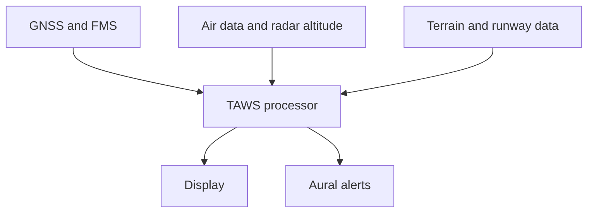

------------------------------------------------------------------------------------------------------------
# TAWS / EGPWS and Runway Awareness

[Operation](#operation)

[System Diagram](#system-diagram)

[Testing](#testing)

[More Reading](#more-reading)

------------------------------------------------------------------------------------------------------------

Terrain awareness systems compare aircraft position, altitude and projected flight path with terrain and obstacle data. Modern systems can also incorporate runway awareness functions.

## Operation

**Inputs:** GNSS position, air data, radar altitude, configuration and flight path information as installed.

**Processing:** Forward-looking terrain awareness is distinct from reactive ground proximity modes. Database validity and position integrity influence the available functions. Runway advisory and overrun awareness features depend on the equipped system.

**Outputs:** Aural alerts, visual annunciations and terrain overlays are distributed to cockpit systems.

## System Diagram

Conceptual signal flow; individual aircraft configurations vary.

## Testing

Unexpected alerts may reflect position, altitude, configuration or database issues rather than a failed computer. Compare input validity and independent sources; avoid bypassing warning functions for troubleshooting.

Training theory only; use applicable aircraft and equipment maintenance instructions for live tests and limits.

### More Reading

[FAA Aviation Maintenance Technician Handbook – Airframe, Chapter 11](https://www.faa.gov/regulations_policies/handbooks_manuals/aviation/FAA-H-8083-31B_Aviation_Maintenance_Technician_Handbook.pdf) — foundational reference; modern system details are supplementary training theory.

[Related lesson: Radar Altimeter](../Radar%20Altimeter/README.md)

[Back to DuncanU](../README.md)
