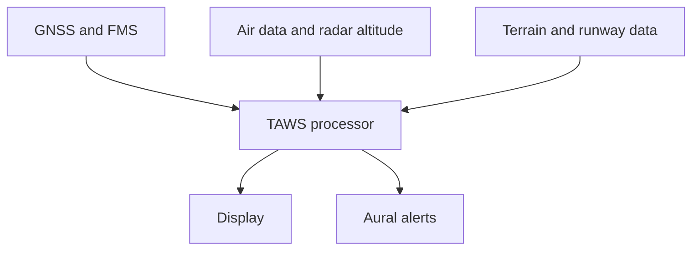

------------------------------------------------------------------------------------------------------------
# TAWS / EGPWS and Runway Awareness

[Operation](#operation)

[System Diagram](#system-diagram)

[Testing](#testing)

[More Reading](#more-reading)

------------------------------------------------------------------------------------------------------------

Terrain awareness systems compare aircraft position, altitude and projected flight path with terrain and obstacle data. Modern systems can also incorporate runway awareness functions.

## Operation

**Inputs:** GNSS position, air data, radar altitude, configuration and flight path information as installed.

**Processing:** Reactive GPWS functions can monitor excessive descent, terrain closure, altitude loss after takeoff, unsafe terrain clearance and deviation below glideslope, as equipped. Enhanced forward-looking terrain awareness compares projected flight path with database terrain and obstacles using position and altitude. Neither function guarantees detection of all hazards. Database validity and position integrity influence the available functions. Runway advisory and overrun awareness features depend on the equipped system.

**Outputs:** Aural alerts, visual annunciations and terrain overlays are distributed to cockpit systems.

## System Diagram

Conceptual signal flow; individual aircraft configurations vary.

## Testing

Unexpected alerts may reflect position, altitude, configuration or database issues rather than a failed computer. Compare input validity and independent sources; avoid bypassing warning functions for troubleshooting.

Training theory only; use applicable aircraft and equipment maintenance instructions for live tests and limits.

### More Reading

[Honeywell — MK VI EGPWS technical feature overview](https://aerospace2.honeywell.com/onlineordering/system-config/systemconfigDisplay?catalogId=10251&categoryId=41)

[FAA AIM — flight hazards and safety systems](https://www.faa.gov/air_traffic/publications/aim_html/chap7_section_6.html)

[FAA Aviation Maintenance Technician Handbook – Airframe, Chapter 11](https://www.faa.gov/regulations_policies/handbooks_manuals/aviation/FAA-H-8083-31B_Aviation_Maintenance_Technician_Handbook.pdf) — foundational reference; modern system details are supplementary training theory.

[Related lesson: Radar Altimeter](../Radar%20Altimeter/README.md)

[Back to DuncanU](../README.md)
