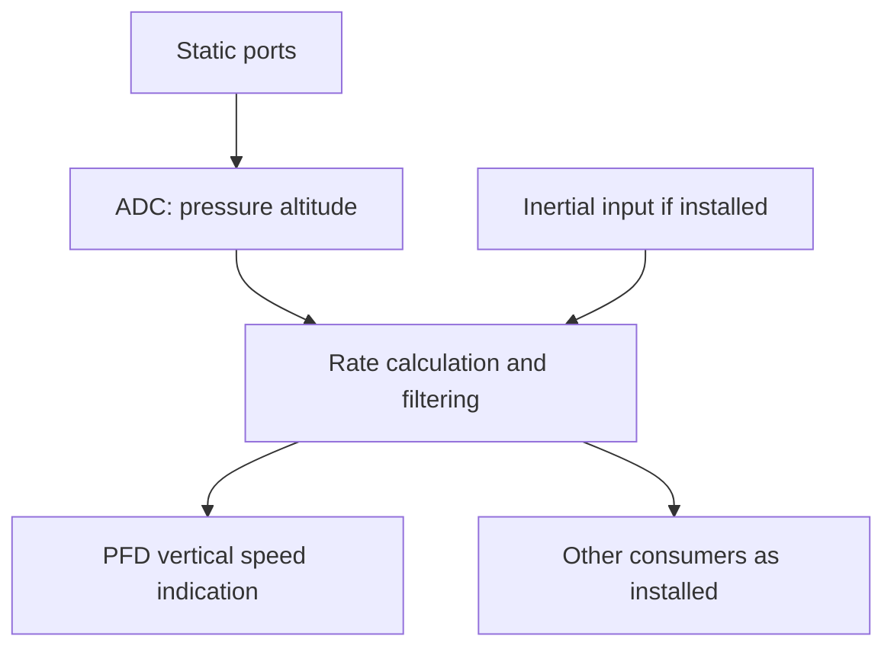

------------------------------------------------------------------------------------------------------------
# Vertical Speed Indicator (VSI) and Digital Vertical Speed

**Core lesson: approximately 5 minutes.** Optional references are outside the timed lesson.

[Operation](#operation)

[System Diagram](#system-diagram)

[Testing](#testing)

[Knowledge Check](#knowledge-check)

[More Reading](#more-reading)

------------------------------------------------------------------------------------------------------------

Vertical speed indicates the rate of climb or descent, normally in feet per minute. Modern corporate aircraft commonly display it on an electronic PFD using air data and, on some installations, inertial aiding.

## Operation

**Barometric vertical speed:** The ADC converts static pressure into pressure altitude and estimates its rate of change. Filtering reduces noise but introduces a response delay. For example, a pressure altitude increase of 100 feet in 6 seconds corresponds to an average climb rate of 1,000 feet per minute.

**Inertial aiding:** Some integrated flight decks combine pressure-based vertical speed with inertial information for improved transient response. GNSS vertical velocity is a separate quantity and is not universally interchangeable with barometric vertical speed.

**Legacy reference:** A mechanical VSI used a calibrated restriction and pressure differential to indicate pressure change. Modern digital systems perform the corresponding calculation electronically.

## System Diagram

Conceptual signal flow; aircraft installations vary.

## Testing

| Symptom | Possible fault domain |
| --- | --- |
| Altitude frozen and vertical speed trends to zero | Trapped static pressure, ADC or shared input |
| Altitude changes normally but VSI is invalid | Rate processing, data interface or display |
| Noisy vertical speed on one side | Static pressure disturbances, sensor or filtering |

Compare redundant sources and the response to an approved controlled pressure change. Do not apply arbitrary pressure rates or limits; the installed system and connected instruments determine safe test conditions.

## Knowledge Check

Why can a blocked static source cause barometric vertical speed to settle near zero?

Answer

Trapped static pressure no longer follows the changing ambient pressure, so the computed pressure-altitude rate tends toward zero. Other sensor aiding or invalid-data logic may change the indication.

### More Reading

[FAA AMT Handbook – Airframe, Chapter 10: aircraft instruments and vertical speed](https://www.faa.gov/regulations_policies/handbooks_manuals/aviation/FAA-H-8083-31B_Aviation_Maintenance_Technician_Handbook.pdf)

[Related lesson: Pitot Static](../Pitot%20Static/Quick%20Lesson.md)

[Related lesson: ADC](../Air%20Data%20Computer/README.md)

[Back to DuncanU](../README.md)
