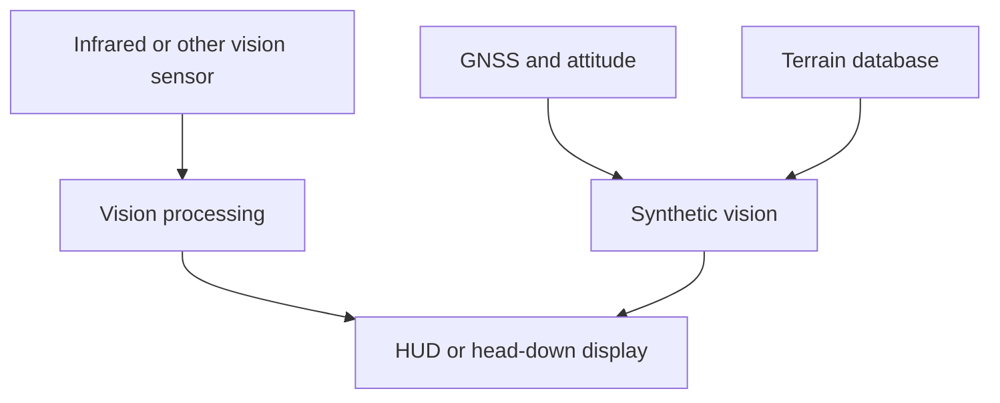

------------------------------------------------------------------------------------------------------------
# HUD, Enhanced and Synthetic Vision

[Operation](#operation)

[System Diagram](#system-diagram)

[Testing](#testing)

[More Reading](#more-reading)

------------------------------------------------------------------------------------------------------------

Corporate aircraft can use head-up displays and electronic vision systems to present guidance or environmental information. HUD, EVS/EFVS and SVS describe different functions.

## Operation

**HUD:** An optical display presents collimated symbology in the pilot's forward view. Alignment and source validity affect accuracy.

**EVS:** A sensor, often infrared, produces an image of the external environment. EFVS is an integrated capability with specific system features, not simply any infrared camera.

**SVS:** Computer-generated terrain and features use position, attitude and databases. Combined vision can integrate real sensor imagery with synthetic information.

## System Diagram

Conceptual signal flow; individual aircraft configurations vary.

## Testing

Image loss may originate in sensor power, optics, video processing or network links. A synthetic image can be displayed without a working external camera. Alignment is aircraft-specific; do not use a generic adjustment method.

Training theory only; use applicable aircraft and equipment maintenance instructions for live tests and limits.

### More Reading

[FAA Aviation Maintenance Technician Handbook – Airframe, Chapter 10](https://www.faa.gov/regulations_policies/handbooks_manuals/aviation/FAA-H-8083-31B_Aviation_Maintenance_Technician_Handbook.pdf) — foundational reference; modern system details are supplementary training theory.

[Related lesson: EFIS](../EFIS/README.md)

[Back to DuncanU](../README.md)
