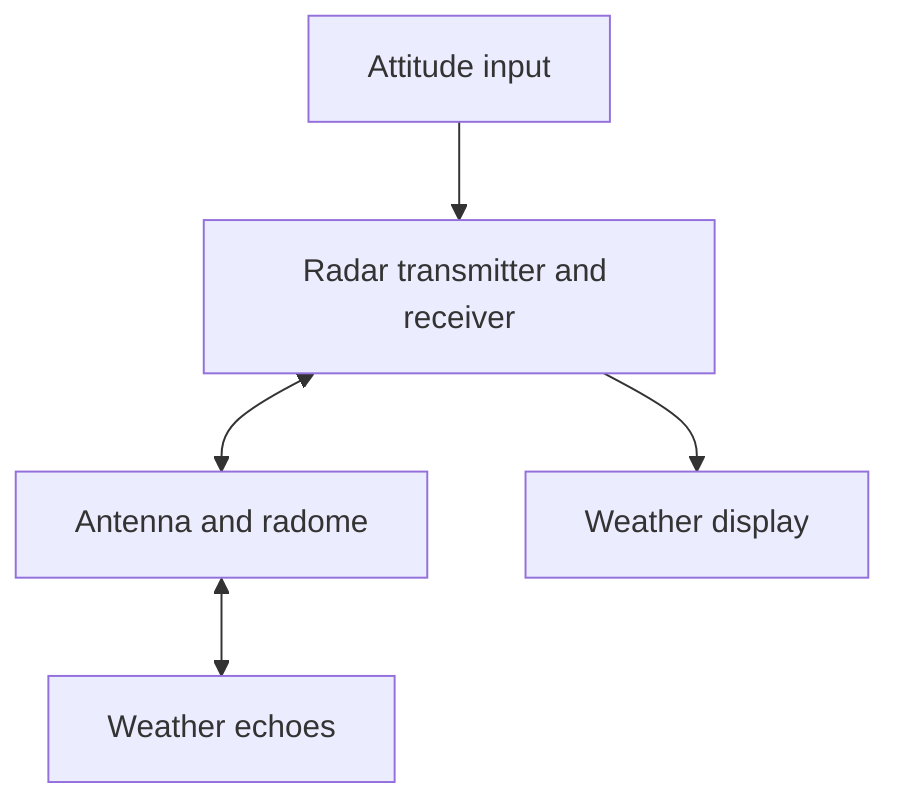

------------------------------------------------------------------------------------------------------------
# Airborne Weather Radar and Windshear Detection

[Operation](#operation)

[System Diagram](#system-diagram)

[Testing](#testing)

[More Reading](#more-reading)

[Videos](#videos)

------------------------------------------------------------------------------------------------------------

Airborne weather radar transmits microwave energy and analyzes reflected signals to depict precipitation. Many business aircraft use X-band radar near 9–10 GHz; actual frequency depends on the equipment.

## Operation

**Transmitter/receiver:** Pulse timing determines range and echo amplitude supports reflectivity estimates. Doppler processing on capable systems measures radial motion.

**Antenna and stabilization:** Antenna steering or electronic scanning controls beam direction. Attitude inputs compensate for aircraft motion. Radome attenuation and beam shape affect detection.

**Windshear:** Predictive radar can identify certain hazardous velocity patterns ahead; reactive warning systems use measured aircraft performance and air data. Not every radar supports predictive windshear. Heavy precipitation can attenuate the beam and hide weather beyond it. Weak or absent returns do not prove a clear path. Airborne radar and delayed ground-radar uplink imagery are different sources.

## System Diagram

Conceptual signal flow; individual aircraft configurations vary.

## Testing

| Symptom | Possible fault domain |
| --- | --- |
| No image or radar flag | Power, data link, control or radar LRU |
| Image tilts with aircraft | Stabilization input or antenna control |
| Poor detection | Radome, antenna, RF path or environment |

RF emissions and moving antennas are hazards. Never transmit in an unsafe ground environment; use approved test modes and equipment.

Training theory only; use applicable aircraft and equipment maintenance instructions for live tests and limits.

### More Reading

[FAA Aviation Maintenance Technician Handbook – Airframe, Chapter 11](https://www.faa.gov/regulations_policies/handbooks_manuals/aviation/FAA-H-8083-31B_Aviation_Maintenance_Technician_Handbook.pdf) — foundational reference; modern system details are supplementary training theory.

[Garmin — interpreting radar returns](https://support.garmin.com/en-ZA/aviation/faq/5PNo1lOYK437plZMBvGbB6/)

[Garmin — tilt angle and ground clutter](https://support.garmin.com/en-US/?faq=UnYMPI3uV691hGMaI3XLU9)

### Videos

[Garmin — Airborne Weather Radar Fundamentals](https://www.youtube.com/watch?v=yJjTGyYudGo) — manufacturer webinar on radar operation and limitations.

[Back to DuncanU](../README.md)
