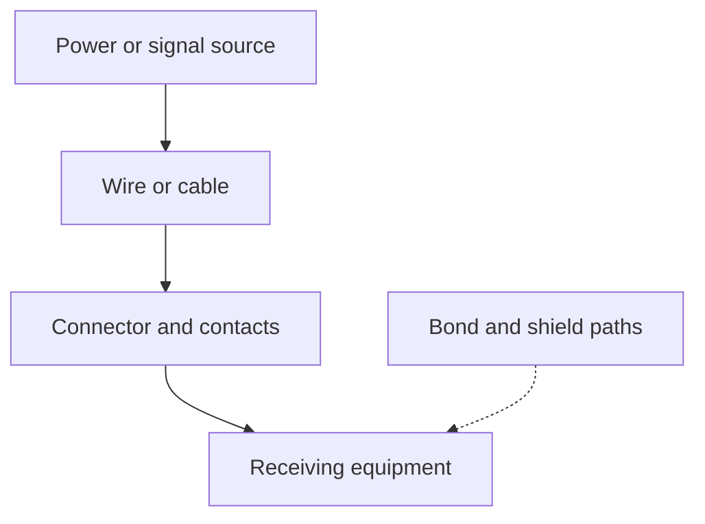

------------------------------------------------------------------------------------------------------------
# Aircraft Wiring, Connectors, Bonding and Shielding

[Operation](#operation)

[System Diagram](#system-diagram)

[Testing](#testing)

[More Reading](#more-reading)

------------------------------------------------------------------------------------------------------------

Avionics wiring carries power, analog signals, RF and digital data. Installation quality influences reliability and electromagnetic compatibility (EMC).

## Operation

**EWIS and connectors:** Wire gauge, insulation, routing, separation, bend radius and strain relief affect reliability. Circular, D-sub, coaxial and Quadrax contacts serve different interface types. Fiber connectors require inspection and cleaning with suitable tools.

**Bonding and shielding:** Bonding provides a low-impedance connection for intended current paths. Shields reduce coupling; the required termination arrangement depends on signal and installation. DC resistance alone does not characterize high-frequency impedance.

**EMI, HIRF and lightning:** Shielding, routing, bonding and transient protection limit unintended coupling and induced voltages. Incorrect shield changes can worsen interference.

## System Diagram

Conceptual signal flow; individual aircraft configurations vary.

## Testing

Inspect for pin damage, corrosion, chafing, incorrect contact retention and poor shield termination. Use the correct contact tooling and test method. Never apply insulation-resistance test voltage to connected sensitive electronics unless specifically permitted.

Training theory only; use applicable aircraft and equipment maintenance instructions for live tests and limits.

### More Reading

[FAA Aviation Maintenance Technician Handbook – Airframe, Chapter 9 and 11](https://www.faa.gov/regulations_policies/handbooks_manuals/aviation/FAA-H-8083-31B_Aviation_Maintenance_Technician_Handbook.pdf) — foundational reference; modern system details are supplementary training theory.

[Related lesson: RF Systems](../RF%20Systems/README.md)

[Back to DuncanU](../README.md)
